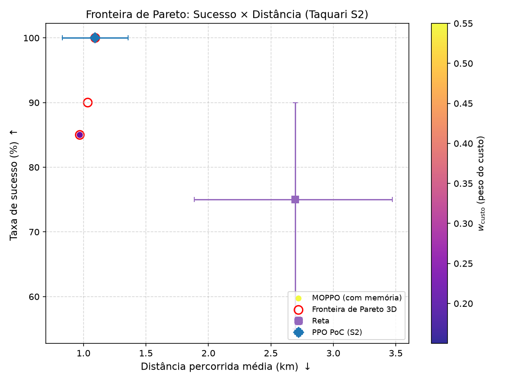
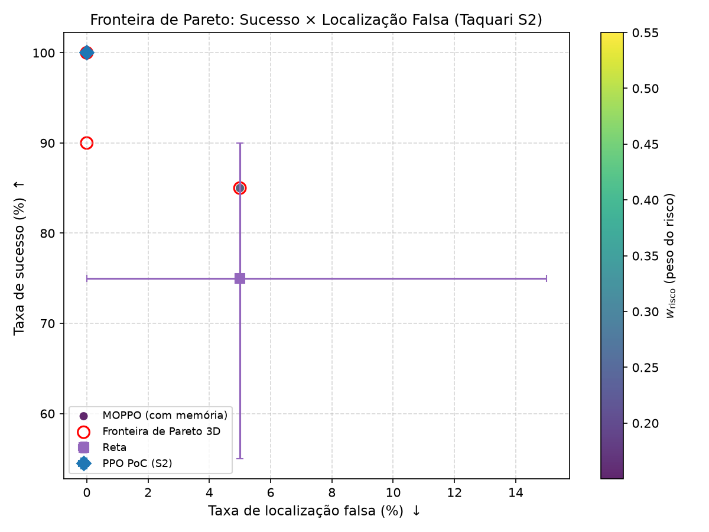

# Apresentação: Localização Ativa Multiobjetivo (MOPPO à la AMOR)

> **Errata (18/11/2026).** Esta página foi corrigida segundo o `REPORT_MO_ERRATA.md`. Na v1, o gate de condicionamento falhou aos 25% do treino, e a política MO deu números idênticos em `fast`, `safe` e `unif`. Vereditos pelo critério original: **H4 não avaliável, H5 não suportada, H6 não suportada, H7 não suportada.** Os vídeos e figuras abaixo mostram **episódios individuais**, escolhidos para ilustrar o funcionamento: não representam o desempenho médio. Os números agregados estão nas tabelas e no `REPORT_MO_ERRATA.md`.

Esta apresentação reúne os resultados experimentais, animações de telemetria e vídeos comparativos da política multiobjetivo condicionada em pesos (**MOPPO**, Alegre et al., SIGGRAPH 2025) com memória curta de ações (**ANL**, Chaplot et al., ICLR 2018), desenvolvida para navegação visual ativa sob incerteza de GPS.

---

## 0. Vídeos Executivos no Estilo Apresentação (Decks PPTX)

> ⚠️ **Não usar estes dois vídeos-deck na apresentação** até serem regenerados: os quadros de conclusão afirmam que a MO "supera" os outros métodos e que a memória "multiplica o hipervolume em ~300%", o que os dados não sustentam (ver errata). Os geradores já foram corrigidos no código, mas os vídeos ainda não foram regenerados.

Foram geradas apresentações executivas em vídeo para o **Vale do Taquari (treino)** e para as **ilhas de Porto Alegre (transferência zero-shot)**:

### A. Apresentação Executiva: Vale do Taquari (Ambiente de Treino)


> 📹 **Arquivo Full HD (1080p, 44s):** [`results_mo/videos/taquari_presentation_deck.mp4`](results_mo/videos/taquari_presentation_deck.mp4) (e [`taquari_presentation_deck_whatsapp.mp4`](results_mo/videos/taquari_presentation_deck_whatsapp.mp4))  
> 🎬 **Conteúdo do Deck:** O relevo do Taquari e a cheia de setembro de 2023, os 3 pilares técnicos (Nuvem de Pontos, MOPPO à la AMOR e Memória ANL), tabela quantitativa de 300 episódios no Taquari S2, voo comparativo dinâmico das 3 políticas no Rio Taquari e conclusões.

### B. Apresentação Executiva: Ilhas de Porto Alegre (Transferência Zero-Shot)


> 📹 **Arquivo Full HD (1080p, 48s):** [`results_mo/videos/poa_ilhas_presentation_deck.mp4`](results_mo/videos/poa_ilhas_presentation_deck.mp4) (e [`poa_ilhas_presentation_deck_whatsapp.mp4`](results_mo/videos/poa_ilhas_presentation_deck_whatsapp.mp4))  
> 🎬 **Conteúdo do Deck:** O fenômeno das ilhas que sumiram sob a lâmina d'água na enchente de maio de 2024, câmera ao vivo pós-enchente vs mapa original pré-enchente, tabela quantitativa pareada e voo comparativo dinâmico no Delta do Jacuí.

---

## 1. O Problema e a Dinâmica de Convergência

Na localização ativa, o drone parte de uma janela de busca de $64 \times 64$ células ($3.2 \times 3.2\text{ km}$), onde sua posição real é inicialmente desconhecida. Um filtro de histograma mantém uma distribuição de probabilidade espacial $b_t \in [0, 1]^{64 \times 64}$ (a "crença").

> **Condição de Sucesso:** A missão é declarada concluída quando pelo menos **90% da massa de probabilidade** do filtro se concentra em um raio de 2 células (100 metros) ao redor da posição estimada. Se o pico estiver correto, ocorre **Sucesso**; se estiver em outro lugar da janela, ocorre **Falsa Localização**.

O vídeo abaixo mostra **um** episódio da política MOPPO no Taquari S2, com sucesso, escolhido para ilustrar como a crença concentra quando a aeronave sobrevoa marcos visuais. No agregado, a MO tem 60,0% de sucesso e 25,0% de localização falsa nesse cenário.


### O que observar na animação acima:
1. **Painel 1 (Esquerda - Mapa Satélite Real & Trajetória):**
   - **Fundo:** Ortofoto aérea real de satélite (Taquari/RS) em cores naturais, evidenciando o Rio Taquari à direita, as matas fechadas, as estradas e os galpões industriais/fazendas.
   - **Contornos Dourados:** Indicam as feições de alta distintividade morfológica calculadas pelo descritor.
   - **Ponto Inicial (círculo azul):** O drone inicia perdido na mata homogênea e voa ativamente em direção ao rio e entroncamento de estradas (linha verde).
   - **Estimativa do Filtro (cruz rosa $\hat{x}_t$):** Converge com precisão sobre o drone conforme ele alcança a margem do rio.
2. **Painel 2 (Centro - Crença Espacial $b_t$ sobre Satélite):**
   - A imagem de satélite escurecida serve de fundo espacial.
   - No início ($t=0$), a crença é uma névoa difusa com pico inferior a $0.2\%$.
   - No passo 18, ocorre o colapso: a probabilidade atinge **48.8% no pico** exatamente sobre o ponto geográfico verdadeiro, finalizando com **LOCALIZAÇÃO COM SUCESSO**.
3. **Painel 3 (Direita - Curvas de Telemetria):**
   - **Entropia de Shannon $H_t$ (curva amarela):** Mede a desordem e incerteza da distribuição. Despenca vertiginosamente de $7.8\text{ nats}$ para menos de $0.5\text{ nats}$.
   - **Erro cartesiano em metros (curva azul tracejada):** O desvio entre o drone e o pico do filtro cai de $730\text{ m}$ para menos de $50\text{ m}$.

---

## 2. Comparação Lado a Lado: MOPPO vs Linha Reta vs Zigue-Zague

**No agregado (Taquari S2, 300 episódios, argmax), a linha reta tem mais sucesso que a MO** (73,0% × 60,0%) e menos localização falsa (10,0% × 25,0%), mas voa mais (2384 m × 1020 m em média, considerando todos os episódios). A comparação abaixo mostra **um episódio** em que a MO se sai melhor. Não é um caso típico.

### Comparação 3-Way com Nuvem de Pontos e Câmera ao Vivo do Drone (Taquari S2)

A animação a seguir apresenta a comparação sincronizada das três políticas (**Linha Reta** vs **Primeiro Treino PPO PoC** vs **Treino MO com Memória**) no Vale do Taquari (Episódio 0, Janela `[381, 50]`), exibindo a **Nuvem de Partículas da Crença** colapsando sobre a ortofoto aérea e, na parte inferior, o recorte real da **Câmera do Drone (Pós-Enchente)** comparado com o **Mapa Original (Pré-Enchente)**:


> 📹 **Arquivo Full HD:** [`results_mo/videos/taquari_comparison_nuvem_pontos_camera.mp4`](results_mo/videos/taquari_comparison_nuvem_pontos_camera.mp4) (e [`taquari_comparison_whatsapp.mp4`](results_mo/videos/taquari_comparison_whatsapp.mp4))  
> - **Treino MO (MOPPO com Memória):** neste episódio, vai rumo à rodovia e à margem do Rio Taquari e converge em **18 passos (1272 m)**.  
> - **Primeiro Treino (PPO PoC S2):** Também busca a margem, mas leva **29 passos**.  
> - **Linha Reta (Straight Baseline):** neste episódio, segue em rumo fixo para o norte, cruzando floresta homogênea por **54 passos (2777 m)**.

---

### Análise do episódio 0 (um único episódio, não representativo):
- **MOPPO (Com Memória):**
  - **Comportamento:** escolhe o rumo a partir da crença e do mapa.
  - **Passos até Sucesso:** 18 passos.
  - **Distância Voada:** 1272 m.
  - **Mecanismo (hipótese, não testada):** a memória curta de ações (ANL) informa à rede os rumos recentes. A comparação com e sem memória da v1 é inconclusiva (1 seed, orçamentos diferentes).
- **Linha Reta (Straight Baseline):**
  - **Comportamento:** rumo fixo, refletindo nas bordas da janela; não usa o mapa para decidir.
  - **Passos até Sucesso:** 54 passos neste episódio.
  - **Distância Voada:** 2777 m neste episódio.
  - **Mecanismo:** cobre terreno novo a cada passo e não depende das previsões do mapa antigo; por isso é uma baseline difícil de bater quando o mapa está desatualizado.
- **Zigue-Zague (Lawnmower):**
  - **Comportamento:** Varredura Sistemática.
  - **Passos:** 80 passos (Esgotou o limite de tempo!).
  - **Distância Voada:** 4186 m (Falha por timeout).
  - **Mecanismo:** Varre faixas paralelas de 4 em 4 células. Em terrenos com poucas referências, passa a maior parte do voo em áreas uniformes e redundantes, acumulando custo sem colapsar a entropia.

### Episódio 2 (outro episódio individual)
Um segundo episódio, também escolhido para ilustração. Ele não sustenta afirmações sobre "frequência": as taxas agregadas estão acima.


---

## 3. Como Funciona a Fronteira de Pareto?

No mundo real, o operador de um drone não busca apenas uma solução única:
- Em missões de emergência com pouca bateria, o objetivo é **minimizar a distância** (preset rápido $w_{\mathrm{rápido}}$).
- Em missões críticas em terreno hostil, o objetivo é **minimizar o risco de falsa localização** (preset seguro $w_{\mathrm{seguro}}$).

A formulação **MOPPO** (*à la* AMOR) treina uma **única rede neural** condicionada em um vetor de pesos $w = [w_{\mathrm{info}}, w_{\mathrm{cost}}, w_{\mathrm{success}}, w_{\mathrm{risk}}]$. O **objetivo** é cobrir o simplex de preferências sem retreino. **Na v1, isso não foi demonstrado:** o gate de condicionamento falhou, e a política deu o mesmo resultado em 32 dos 37 pesos avaliados.

A animação abaixo é **didática**: ilustra o que se espera de uma política condicionada em preferências. Ela não mostra o comportamento medido da política v1.


### Projeções 2D da Fronteira de Pareto 3D:

| Projeção: Sucesso vs Distância | Projeção: Sucesso vs Falsa Localização |
|:---:|:---:|
|  |  |

### O que a fronteira da v1 mostra, e o que não mostra
1. **MO × PPOs de peso fixo (H4): não avaliável.** O gate de condicionamento falhou, e os orçamentos diferem (MO 348k passos, PPOs fixos 225k, PPO da PoC 1,4M). A MO tem mais sucesso que os PPOs fixos (60,0% × 55,7% e 49,7%), mas a comparação não isola o efeito do condicionamento.
2. **Com × sem memória: inconclusivo.** A diferença de hipervolume (0,4232 × 0,1529) está confundida por orçamento (348k × 246k), 1 seed por variante e conjuntos de tamanhos diferentes. **Não use "ganho de 300%".**
3. **Contra a PPO da PoC e a reta:** nos mesmos episódios, a PPO da PoC tem 81,0% / 68,3% / 72,3% de sucesso (seeds 0, 1 e 2) e a reta 73,0%, contra 60,0% da MO.

---

## 4. Transferência Zero-Shot para Porto Alegre (Hipótese H7)

A política treinada exclusivamente em Taquari S2 foi submetida a um teste cego (*zero-shot*) na região insular e urbana de Porto Alegre (cenário P1), enfrentando condições de cheia histórica:

| Região | Método | Sucesso (%) | Falsa Loc. (%) | Distância Média (m) |
|---|---|---|---|---|
| **Ilhas** | **MOPPO `safe`** | 49.0% | **19.7%** | **1028.7 m** |
| Ilhas | MOPPO `fast` | 52.0% | 21.3% | 1054.0 m |
| Ilhas | PPO-S2 PoC | **71.3%** | 21.3% | 1320.8 m |
| Ilhas | Linha Reta | 67.7% | 22.0% | 2160.2 m |
| **Centro** | **MOPPO `safe`** | 70.3% | **1.0%** | **1254.3 m** |
| Centro | PPO-S2 PoC | **90.0%** | 0.7% | 1425.4 m |
| Centro | Linha Reta | 85.0% | 2.7% | 2338.5 m |

> **Veredito H7: não suportada.** Nas ilhas, a localização falsa do `safe` foi 19,7% [15,0; 24,3], contra 21,3% da PPO-S2 (Δ = −1,7 p.p.). O IC da diferença inclui 0, e o critério exige o IC inteiramente abaixo de 0. O sucesso da MO nas ilhas é 49,0%, contra 71,3% da PPO-S2 **nos mesmos episódios**: a queda é da política MO, não do domínio. Na tabela, `safe` e `unif` dão números idênticos (mesmo sintoma do Taquari).

### O Fenômeno das Ilhas Submersas: Nuvem de Pontos e Câmera vs Mapa Original

Durante a enchente de maio de 2024 no Delta do Jacuí, ilhas inteiras desapareceram sob as águas marrons barrentas. O drone decola de um local onde o mapa prévio indicava terra firme e vegetação, mas sua câmera só vê água marrom uniforme!

A animação comparativa abaixo coloca lado a lado:
1. **Linha Reta (`straight`)**
2. **Primeiro Treino (`ppo_s2`, PPO escalar da PoC)**
3. **Treino MO (`moppo`, MOPPO multiobjetivo com memória)**

Cada método exibe a sua **Nuvem de Pontos (partículas ciano da crença espacial)** no mapa principal e, na parte inferior, a visão real da câmera: **O que o Drone Vê (Pós-Enchente / Maio 2024)** comparado a **O que Veria no Mapa Original (Pré-Enchente / Fev 2024)**!


Episódio individual, escolhido para ilustração (no agregado das ilhas, a PPO-S2 tem 71,3% de sucesso, a reta 67,7% e a MO 49,0%):
- **Treino MO (MOPPO com Memória):** 9 passos e 636 m neste episódio; ruma para a margem do canal junto à ponte da BR-290.
- **Primeiro Treino (PPO Escalar):** 14 passos e 824 m neste episódio.
- **Linha Reta:** 67 passos e 3353 m neste episódio; o rumo fixo para leste a leva para a baía inundada, onde só vê água.

---

## 5. Estrutura dos Arquivos de Vídeo e Scripts

Para reproduzir ou gerar novos vídeos, utilize os scripts automatizados:

```bash
# Gerar Apresentação Executiva em Vídeo (Deck PPTX completo)
.venv/bin/python -u -m src.dal.mo_poa_presentation_video

# Gerar vídeos das Ilhas com Nuvem de Pontos e Câmera vs Mapa
.venv/bin/python -u -m src.dal.mo_poa_nuvem_video

# Gerar vídeos do Vale do Taquari
bash scripts/generate_mo_videos.sh

# Gerar demais vídeos de Porto Alegre
.venv/bin/python -u -m src.dal.mo_poa_video
```

Os arquivos gerados estão disponíveis em `results_mo/videos/`:
- `poa_ilhas_presentation_deck.mp4` e `.gif` (Apresentação Executiva Completa estilo PPTX, 1080p, 48s)
- `poa_ilhas_comparison_nuvem_pontos_camera.mp4` e `.gif` (Comparação 3-way com Nuvem de Pontos e Câmera nas Ilhas)
- `poa_ilhas_mo_safe.mp4` e `poa_centro_mo_safe.mp4`
- `episode_0_mo_fast.mp4` e `comparison_ep0_mo_vs_straight_vs_zigzag.mp4` (Taquari)
- `pareto_frontier_explainer.mp4`
