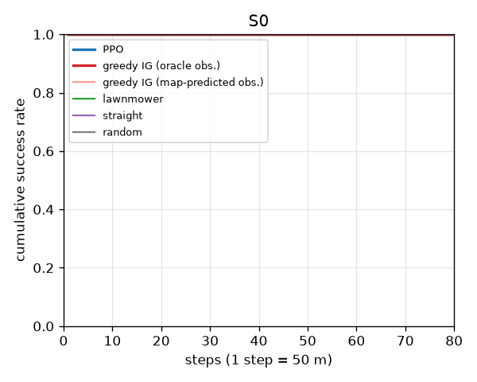
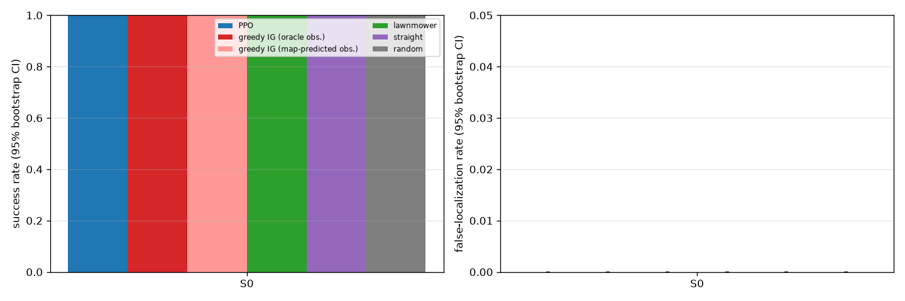
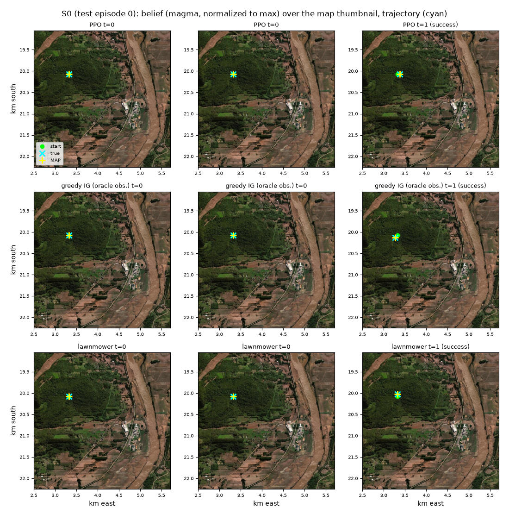
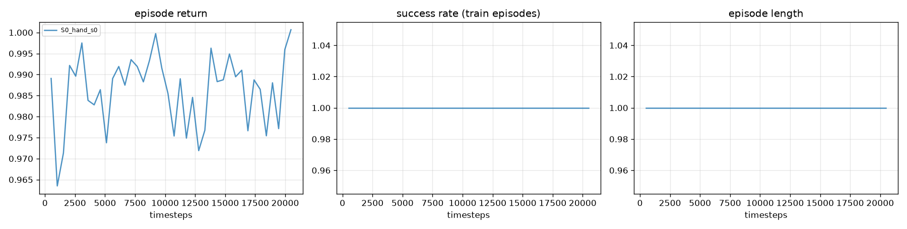

# REPORT: active global localization of a drone with RL on outdated maps

*Generated automatically by `python -m dal.report`. Every number below is read from files in `results/smoke/`.* **SMOKE TEST (20k timesteps, 50 episodes, S0 only): the numbers are NOT meaningful.**

## 1. Data

AOI grid: 141 × 463 cells of 50 m; train rows 0–306 (north), test rows 311–462 (south).

| date | valid | cloud_raw | cloud_refined | cells_ok | dx | dy | offset_m | applied |
|---|---|---|---|---|---|---|---|---|
| post | 0.971 | 0.010 | 0.002 | 0.976 | 0.000 | 0.000 | 0.000 | False |
| pre_mar23 | 0.964 | 0.009 | 0.001 | 0.952 | 2.223 | 1.217 | 2.535 | True |
| pre_oct23 | 1.000 | 0.156 | 0.172 | 0.744 | 4.923 | 0.850 | 4.995 | True |

## 2. Descriptor retrieval (train windows 64×64)

Fraction of observations whose true cell ranks top-k among the valid map cells of the window. `top1_within1`: the best match is within 1 cell. `beta1`: single-observation maximum-likelihood temperature; `kappa`: sequence-level tempering chosen on train episodes; `beta` = kappa·beta1 is what the filter uses. `loglik_*`: mean log-probability of the true cell (β₁) vs uniform.

| descriptor | scenario | top1 | top5 | top1_within1 | chance_top1 | beta1 | kappa | beta | loglik_true | loglik_uniform |
|---|---|---|---|---|---|---|---|---|---|---|
| hand | S0 | 0.998 | 1.000 | 0.999 | 0.000 | 167.131 | 1.000 | 167.131 | -0.004 | -8.307 |
| hand | S1 | 0.409 | 0.523 | 0.424 | 0.000 | 21.569 | 0.250 | 5.392 | -4.183 | -8.302 |
| hand | S2 | 0.269 | 0.355 | 0.282 | 0.000 | 13.909 | 0.250 | 3.477 | -6.087 | -8.114 |
| cnn | S0 | 0.774 | 0.886 | 0.861 | 0.000 | 60.041 | 1.000 | 60.041 | -1.361 | -8.307 |
| cnn | S1 | 0.100 | 0.199 | 0.183 | 0.000 | 13.909 | 0.350 | 4.868 | -6.649 | -8.302 |
| cnn | S2 | 0.078 | 0.169 | 0.158 | 0.000 | 7.749 | 0.700 | 5.424 | -7.168 | -8.114 |

## 3. Sanity gate (train split)

Gate **PASSED**; descriptor chosen: `hand` (200 episodes per cell of the table). Thresholds in S0: greedy ≥ 0.6, lawnmower ≥ 0.4.

| descriptor | scenario | greedy | lawnmower | random | straight |
|---|---|---|---|---|---|
| cnn | S0 | 1.000 | 0.995 | 0.995 | 0.995 |
| cnn | S1 | 0.800 | 0.830 | 0.655 | 0.900 |
| cnn | S2 | 0.555 | 0.590 | 0.545 | 0.630 |
| hand | S0 | 1.000 | 1.000 | 1.000 | 1.000 |
| hand | S1 | 0.900 | 0.960 | 0.860 | 0.980 |
| hand | S2 | 0.565 | 0.645 | 0.500 | 0.730 |

False-localization rate:

| descriptor | scenario | greedy | lawnmower | random | straight |
|---|---|---|---|---|---|
| cnn | S0 | 0.000 | 0.005 | 0.005 | 0.005 |
| cnn | S1 | 0.145 | 0.040 | 0.030 | 0.055 |
| cnn | S2 | 0.350 | 0.120 | 0.095 | 0.300 |
| hand | S0 | 0.000 | 0.000 | 0.000 | 0.000 |
| hand | S1 | 0.090 | 0.030 | 0.085 | 0.020 |
| hand | S2 | 0.275 | 0.075 | 0.145 | 0.100 |

## 4. Test region (south, never seen in training): 50 paired episodes per method × scenario

PPO rows pool all training seeds (`model_seeds`); `success_seed_std` is the std of the success rate across seeds. Steps are over successful episodes only.

| scenario | method | episodes | model_seeds | success | success_seed_std | false_loc | steps (median [IQR]) | final_error_median_m | distance_mean_m | decision_ms |
|---|---|---|---|---|---|---|---|---|---|---|
| S0 | ppo | 50 | 1 | 1.000 [1.000, 1.000] |  | 0.000 [0.000, 0.000] | 1 [1–1] | 0.000 | 52.886 | 1.26 |
| S0 | greedy | 50 | 0 | 1.000 [1.000, 1.000] |  | 0.000 [0.000, 0.000] | 1 [1–1] | 0.000 | 61.413 | 42.87 |
| S0 | greedy_map | 50 | 0 | 1.000 [1.000, 1.000] |  | 0.000 [0.000, 0.000] | 1 [1–1] | 0.000 | 59.106 | 43.73 |
| S0 | lawnmower | 50 | 0 | 1.000 [1.000, 1.000] |  | 0.000 [0.000, 0.000] | 1 [1–1] | 0.000 | 51.886 | 0.00 |
| S0 | straight | 50 | 0 | 1.000 [1.000, 1.000] |  | 0.000 [0.000, 0.000] | 1 [1–1] | 0.000 | 56.520 | 0.00 |
| S0 | random | 50 | 0 | 1.000 [1.000, 1.000] |  | 0.000 [0.000, 0.000] | 1 [1–1] | 0.000 | 56.520 | 0.01 |

### Paired tests: PPO vs each method

`success_diff` = PPO − other (paired bootstrap 95% CI). Wilcoxon signed-rank test on per-episode penalized steps (failure = 81).

| scenario | vs | n | success_diff | success_diff_lo | success_diff_hi | pen_steps_ref | pen_steps_other | wilcoxon_p |
|---|---|---|---|---|---|---|---|---|
| S0 | greedy | 50 | 0.000 | 0.000 | 0.000 | 1.000 | 1.000 | 1 |
| S0 | greedy_map | 50 | 0.000 | 0.000 | 0.000 | 1.000 | 1.000 | 1 |
| S0 | lawnmower | 50 | 0.000 | 0.000 | 0.000 | 1.000 | 1.000 | 1 |
| S0 | random | 50 | 0.000 | 0.000 | 0.000 | 1.000 | 1.000 | 1 |
| S0 | straight | 50 | 0.000 | 0.000 | 0.000 | 1.000 | 1.000 | 1 |

## 5. Training region (north), 30 episodes, used for H3

| scenario | method | episodes | success | false_loc | steps_median | decision_ms |
|---|---|---|---|---|---|---|
| S0 | ppo | 30 | 1.000 | 0.000 | 1.000 | 1.082 |
| S0 | greedy | 30 | 1.000 | 0.000 | 1.000 | 39.707 |
| S0 | lawnmower | 30 | 1.000 | 0.000 | 1.000 | 0.003 |
| S0 | straight | 30 | 1.000 | 0.000 | 1.000 | 0.002 |
| S0 | random | 30 | 1.000 | 0.000 | 1.000 | 0.012 |

## 6. Training curves

| name | timesteps | seconds | fps |
|---|---|---|---|
| S0_hand_s0 | 20480 | 77.335 | 264.820 |

## 7. Hypotheses

### H1: **inconclusive**

Criterion (per scenario): PPO beats every simple baseline (paired-bootstrap CI of Δsuccess > 0, Wilcoxon p < 0.05 on penalized steps, PPO median not worse; against a baseline already at ≥ 0.98 success: Δsuccess ≥ −1 pp and significantly fewer steps) AND Δsuccess vs greedy ≥ −5 pp. Holds in 0/0 discriminative scenarios.

Excluded as degenerate (all simple baselines ≥ 0.98 success in ≤ 2 steps): S0.

### H2: **inconclusive**

Criterion: the advantage increases monotonically S0 < S1 < S2 and the 95% CIs of S0 and S2 do not overlap (supported); monotone or S2 > S0 without separation (inconclusive); otherwise not supported.

- S0: PPO − best simple baseline (straight) = +0.000 [+0.000, +0.000]

### H3: **inconclusive**

Criterion (per scenario): in the unseen south region PPO still beats the best simple baseline (CI > 0) and its gap to the training-free greedy reference shrinks by at most 5 pp relative to the north (training) region.

Excluded as degenerate (all simple baselines ≥ 0.98 success in ≤ 2 steps): S0.

