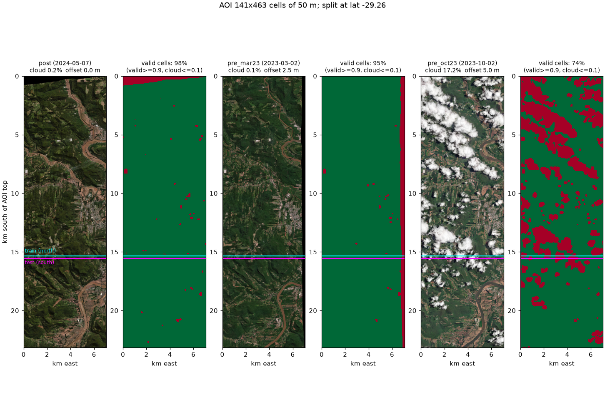
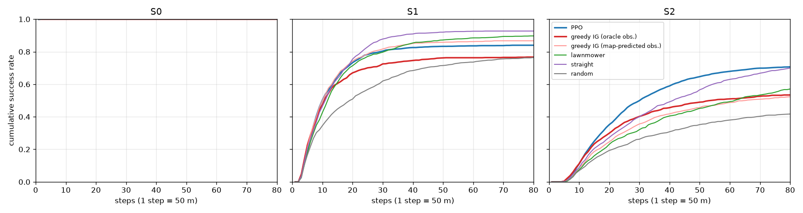
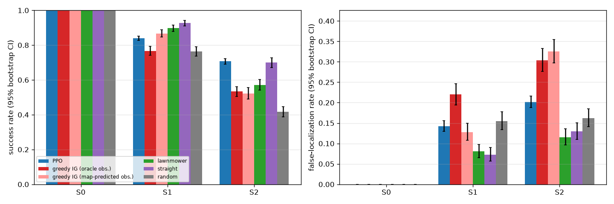
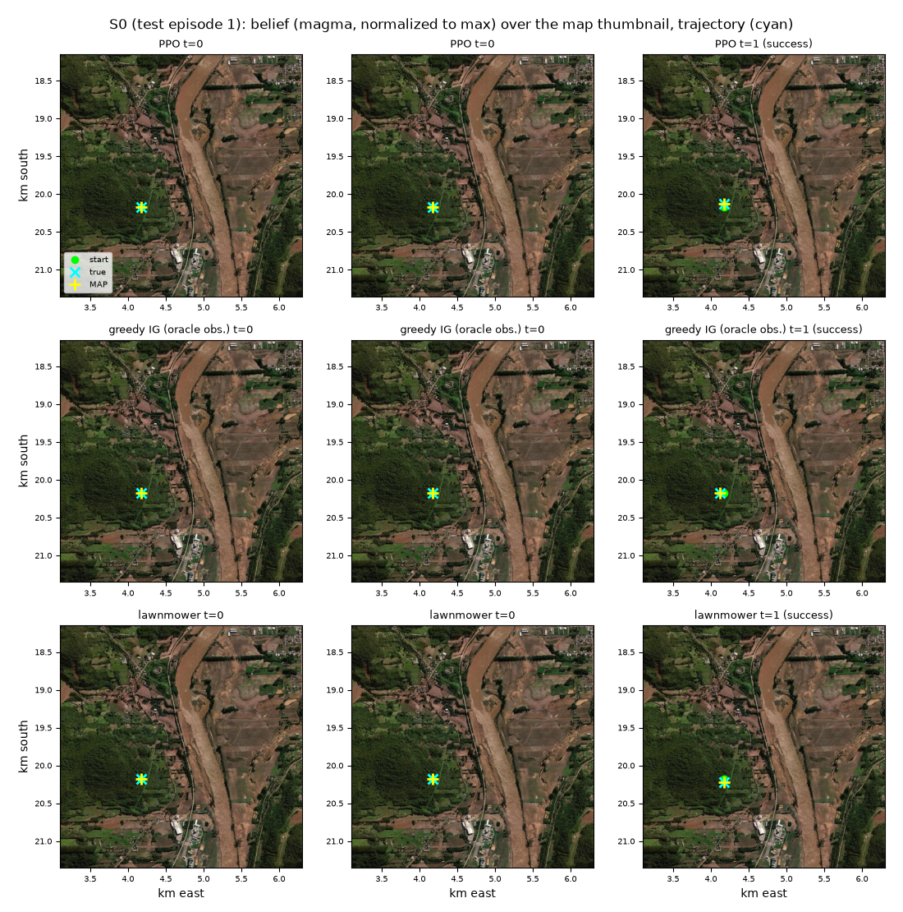
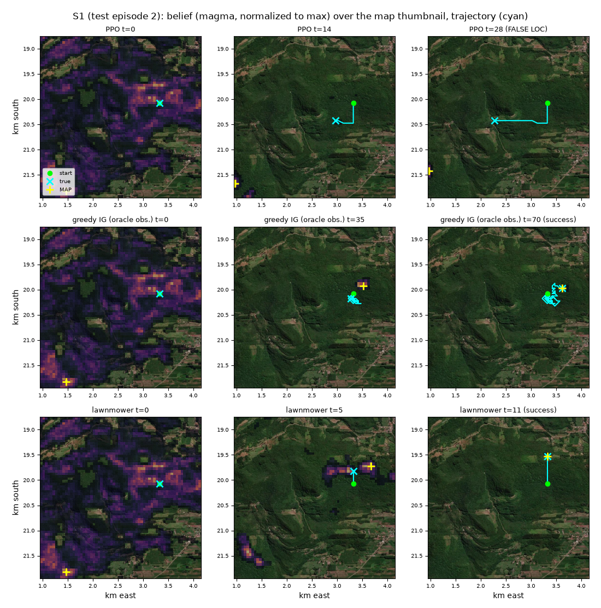
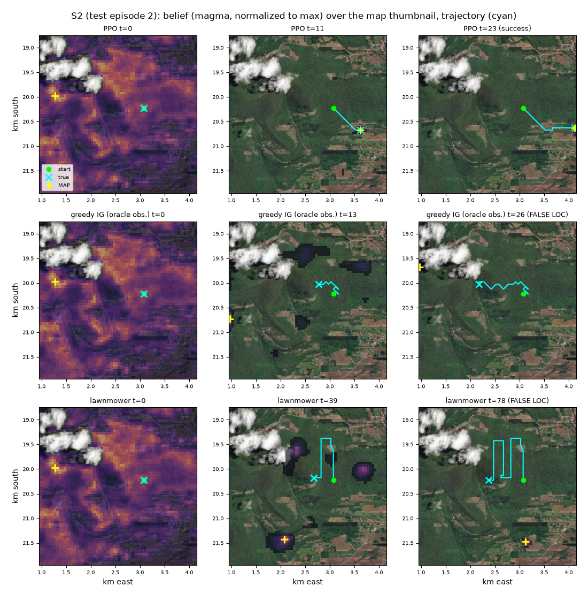
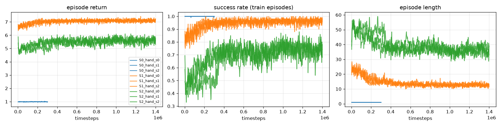

# REPORT: active global localization of a drone with RL on outdated maps

*Generated automatically by `python -m dal.report`. Every number below is read from files in `results/`.*

## 1. Data

AOI grid: 141 × 463 cells of 50 m; train rows 0–306 (north), test rows 311–462 (south).

| date | valid | cloud_raw | cloud_refined | cells_ok | dx | dy | offset_m | applied |
|---|---|---|---|---|---|---|---|---|
| post | 0.971 | 0.010 | 0.002 | 0.976 | 0.000 | 0.000 | 0.000 | False |
| pre_mar23 | 0.964 | 0.009 | 0.001 | 0.952 | 2.223 | 1.217 | 2.535 | True |
| pre_oct23 | 1.000 | 0.156 | 0.172 | 0.744 | 4.923 | 0.850 | 4.995 | True |

## 2. Descriptor retrieval (train windows 64×64)

Fraction of observations whose true cell ranks top-k among the valid map cells of the window. `top1_within1`: the best match is within 1 cell. `beta1`: single-observation maximum-likelihood temperature; `kappa`: sequence-level tempering chosen on train episodes; `beta` = kappa·beta1 is what the filter uses. `loglik_*`: mean log-probability of the true cell (β₁) vs uniform.

| descriptor | scenario | top1 | top5 | top1_within1 | chance_top1 | beta1 | kappa | beta | loglik_true | loglik_uniform |
|---|---|---|---|---|---|---|---|---|---|---|
| hand | S0 | 0.998 | 1.000 | 0.999 | 0.000 | 167.131 | 1.000 | 167.131 | -0.004 | -8.307 |
| hand | S1 | 0.409 | 0.523 | 0.424 | 0.000 | 21.569 | 0.250 | 5.392 | -4.183 | -8.302 |
| hand | S2 | 0.269 | 0.355 | 0.282 | 0.000 | 13.909 | 0.250 | 3.477 | -6.087 | -8.114 |
| cnn | S0 | 0.774 | 0.886 | 0.861 | 0.000 | 60.041 | 1.000 | 60.041 | -1.361 | -8.307 |
| cnn | S1 | 0.100 | 0.199 | 0.183 | 0.000 | 13.909 | 0.350 | 4.868 | -6.649 | -8.302 |
| cnn | S2 | 0.078 | 0.169 | 0.158 | 0.000 | 7.749 | 0.700 | 5.424 | -7.168 | -8.114 |

## 3. Sanity gate (train split)

Gate **PASSED**; descriptor chosen: `hand` (200 episodes per cell of the table). Thresholds in S0: greedy ≥ 0.6, lawnmower ≥ 0.4.

| descriptor | scenario | greedy | lawnmower | random | straight |
|---|---|---|---|---|---|
| cnn | S0 | 1.000 | 0.995 | 0.995 | 0.995 |
| cnn | S1 | 0.800 | 0.830 | 0.655 | 0.900 |
| cnn | S2 | 0.555 | 0.590 | 0.545 | 0.630 |
| hand | S0 | 1.000 | 1.000 | 1.000 | 1.000 |
| hand | S1 | 0.900 | 0.960 | 0.860 | 0.980 |
| hand | S2 | 0.565 | 0.645 | 0.500 | 0.730 |

False-localization rate:

| descriptor | scenario | greedy | lawnmower | random | straight |
|---|---|---|---|---|---|
| cnn | S0 | 0.000 | 0.005 | 0.005 | 0.005 |
| cnn | S1 | 0.145 | 0.040 | 0.030 | 0.055 |
| cnn | S2 | 0.350 | 0.120 | 0.095 | 0.300 |
| hand | S0 | 0.000 | 0.000 | 0.000 | 0.000 |
| hand | S1 | 0.090 | 0.030 | 0.085 | 0.020 |
| hand | S2 | 0.275 | 0.075 | 0.145 | 0.100 |

## 4. Test region (south, never seen in training): 1000 paired episodes per method × scenario

PPO rows pool all training seeds (`model_seeds`); `success_seed_std` is the std of the success rate across seeds. Steps are over successful episodes only.

| scenario | method | episodes | model_seeds | success | success_seed_std | false_loc | steps (median [IQR]) | final_error_median_m | distance_mean_m | decision_ms |
|---|---|---|---|---|---|---|---|---|---|---|
| S0 | ppo | 3000 | 3 | 1.000 [1.000, 1.000] | 0.000 | 0.000 [0.000, 0.000] | 1 [1–1] | 0.000 | 51.478 | 4.10 |
| S0 | greedy | 1000 | 0 | 1.000 [1.000, 1.000] |  | 0.000 [0.000, 0.000] | 1 [1–1] | 0.000 | 61.608 | 158.68 |
| S0 | greedy_map | 1000 | 0 | 1.000 [1.000, 1.000] |  | 0.000 [0.000, 0.000] | 1 [1–1] | 0.000 | 60.943 | 112.44 |
| S0 | lawnmower | 1000 | 0 | 1.000 [1.000, 1.000] |  | 0.000 [0.000, 0.000] | 1 [1–1] | 0.000 | 51.345 | 0.01 |
| S0 | straight | 1000 | 0 | 1.000 [1.000, 1.000] |  | 0.000 [0.000, 0.000] | 1 [1–1] | 0.000 | 59.551 | 0.00 |
| S0 | random | 1000 | 0 | 1.000 [1.000, 1.000] |  | 0.000 [0.000, 0.000] | 1 [1–1] | 0.000 | 59.551 | 0.05 |
| S1 | ppo | 3000 | 3 | 0.840 [0.826, 0.853] | 0.046 | 0.142 [0.130, 0.155] | 9 [6–15] | 0.000 | 656.304 | 3.68 |
| S1 | greedy | 1000 | 0 | 0.767 [0.741, 0.793] |  | 0.220 [0.194, 0.246] | 8 [5–13] | 0.000 | 779.119 | 133.42 |
| S1 | greedy_map | 1000 | 0 | 0.867 [0.846, 0.888] |  | 0.128 [0.108, 0.149] | 9 [6–15] | 0.000 | 730.140 | 141.22 |
| S1 | lawnmower | 1000 | 0 | 0.897 [0.878, 0.916] |  | 0.081 [0.065, 0.098] | 11 [6–18] | 0.000 | 870.752 | 0.01 |
| S1 | straight | 1000 | 0 | 0.927 [0.911, 0.943] |  | 0.073 [0.057, 0.090] | 10 [6–18] | 0.000 | 807.059 | 0.01 |
| S1 | random | 1000 | 0 | 0.764 [0.737, 0.790] |  | 0.155 [0.134, 0.178] | 12 [6–26] | 0.000 | 1520.806 | 0.03 |
| S2 | ppo | 3000 | 3 | 0.707 [0.691, 0.723] | 0.073 | 0.202 [0.188, 0.216] | 21 [13–33] | 0.000 | 1242.826 | 3.31 |
| S2 | greedy | 1000 | 0 | 0.534 [0.505, 0.562] |  | 0.304 [0.277, 0.333] | 18 [11–30] | 50.000 | 1631.514 | 136.37 |
| S2 | greedy_map | 1000 | 0 | 0.523 [0.491, 0.555] |  | 0.325 [0.297, 0.355] | 22 [13–35] | 50.000 | 1660.914 | 147.06 |
| S2 | lawnmower | 1000 | 0 | 0.571 [0.541, 0.602] |  | 0.115 [0.096, 0.136] | 26 [15–46] | 0.000 | 2475.182 | 0.01 |
| S2 | straight | 1000 | 0 | 0.700 [0.671, 0.728] |  | 0.130 [0.110, 0.151] | 26 [14–45] | 0.000 | 2366.363 | 0.01 |
| S2 | random | 1000 | 0 | 0.417 [0.387, 0.447] |  | 0.162 [0.141, 0.185] | 23 [13–41] | 206.155 | 3196.141 | 0.03 |

### Paired tests: PPO vs each method

`success_diff` = PPO − other (paired bootstrap 95% CI). Wilcoxon signed-rank test on per-episode penalized steps (failure = 81).

| scenario | vs | n | success_diff | success_diff_lo | success_diff_hi | pen_steps_ref | pen_steps_other | wilcoxon_p |
|---|---|---|---|---|---|---|---|---|
| S0 | greedy | 1000 | 0.000 | 0.000 | 0.000 | 1.000 | 1.000 | 0.1 |
| S0 | greedy_map | 1000 | 0.000 | 0.000 | 0.000 | 1.000 | 1.000 | 0.1 |
| S0 | lawnmower | 1000 | 0.000 | 0.000 | 0.000 | 1.000 | 1.000 | 0.41 |
| S0 | random | 1000 | 0.000 | 0.000 | 0.000 | 1.000 | 1.000 | 0.79 |
| S0 | straight | 1000 | 0.000 | 0.000 | 0.000 | 1.000 | 1.000 | 0.79 |
| S1 | greedy | 1000 | 0.073 | 0.043 | 0.102 | 12.000 | 11.000 | 0.00091 |
| S1 | greedy_map | 1000 | -0.027 | -0.053 | -0.001 | 12.000 | 10.000 | 0.035 |
| S1 | lawnmower | 1000 | -0.057 | -0.082 | -0.034 | 12.000 | 12.000 | 0.39 |
| S1 | random | 1000 | 0.076 | 0.047 | 0.105 | 12.000 | 19.500 | 3.4e-23 |
| S1 | straight | 1000 | -0.087 | -0.110 | -0.063 | 12.000 | 11.000 | 6.9e-06 |
| S2 | greedy | 1000 | 0.173 | 0.137 | 0.206 | 40.667 | 54.000 | 1.2e-14 |
| S2 | greedy_map | 1000 | 0.184 | 0.151 | 0.218 | 40.667 | 65.500 | 1.2e-26 |
| S2 | lawnmower | 1000 | 0.136 | 0.102 | 0.170 | 40.667 | 62.000 | 4.6e-29 |
| S2 | random | 1000 | 0.290 | 0.255 | 0.323 | 40.667 | 81.000 | 3.8e-56 |
| S2 | straight | 1000 | 0.007 | -0.027 | 0.040 | 40.667 | 42.000 | 5.6e-06 |

## 5. Training region (north), 300 episodes, used for H3

| scenario | method | episodes | success | false_loc | steps_median | decision_ms |
|---|---|---|---|---|---|---|
| S0 | ppo | 900 | 1.000 | 0.000 | 1.000 | 4.296 |
| S0 | greedy | 300 | 1.000 | 0.000 | 1.000 | 147.232 |
| S0 | lawnmower | 300 | 1.000 | 0.000 | 1.000 | 0.007 |
| S0 | straight | 300 | 1.000 | 0.000 | 1.000 | 0.004 |
| S0 | random | 300 | 1.000 | 0.000 | 1.000 | 0.028 |
| S1 | ppo | 900 | 0.917 | 0.070 | 8.000 | 3.897 |
| S1 | greedy | 300 | 0.910 | 0.070 | 8.000 | 137.427 |
| S1 | lawnmower | 300 | 0.957 | 0.037 | 9.000 | 0.006 |
| S1 | straight | 300 | 0.980 | 0.020 | 8.500 | 0.007 |
| S1 | random | 300 | 0.850 | 0.087 | 10.000 | 0.039 |
| S2 | ppo | 900 | 0.701 | 0.194 | 20.000 | 3.048 |
| S2 | greedy | 300 | 0.597 | 0.270 | 16.000 | 140.312 |
| S2 | lawnmower | 300 | 0.650 | 0.063 | 26.000 | 0.007 |
| S2 | straight | 300 | 0.760 | 0.100 | 24.000 | 0.005 |
| S2 | random | 300 | 0.487 | 0.137 | 23.000 | 0.027 |

## 6. Training curves

| name | timesteps | seconds | fps |
|---|---|---|---|
| S0_hand_s0 | 301056 | 850.358 | 354.035 |
| S0_hand_s1 | 301056 | 863.090 | 348.812 |
| S0_hand_s2 | 301056 | 869.091 | 346.403 |
| S1_hand_s0 | 1400832 | 2793.912 | 501.387 |
| S1_hand_s1 | 1400832 | 2787.996 | 502.451 |
| S1_hand_s2 | 1400832 | 2853.857 | 490.856 |
| S2_hand_s0 | 1400832 | 2746.661 | 510.013 |
| S2_hand_s1 | 1400832 | 2755.306 | 508.413 |
| S2_hand_s2 | 1400832 | 2796.266 | 500.965 |

## 7. Hypotheses

### H1: **not supported**

Criterion (per scenario): PPO beats every simple baseline (paired-bootstrap CI of Δsuccess > 0, Wilcoxon p < 0.05 on penalized steps, PPO median not worse; against a baseline already at ≥ 0.98 success: Δsuccess ≥ −1 pp and significantly fewer steps) AND Δsuccess vs greedy ≥ −5 pp. Holds in 0/2 discriminative scenarios.

Excluded as degenerate (all simple baselines ≥ 0.98 success in ≤ 2 steps): S0.

- S1: PPO vs straight: Δsuccess = -0.087 [-0.110, -0.063], Wilcoxon p = 6.9e-06 → not better
- S1: PPO vs lawnmower: Δsuccess = -0.057 [-0.082, -0.034], Wilcoxon p = 0.39 → not better
- S1: PPO vs random: Δsuccess = +0.076 [+0.047, +0.105], Wilcoxon p = 3.4e-23 → better
- S1: PPO vs greedy IG: Δsuccess = +0.073 [+0.043, +0.102] (competitive if ≥ −0.05: yes); decision time greedy/PPO = 36.2×
- S2: PPO vs straight: Δsuccess = +0.007 [-0.027, +0.040], Wilcoxon p = 5.6e-06 → not better
- S2: PPO vs lawnmower: Δsuccess = +0.136 [+0.102, +0.170], Wilcoxon p = 4.6e-29 → better
- S2: PPO vs random: Δsuccess = +0.290 [+0.255, +0.323], Wilcoxon p = 3.8e-56 → better
- S2: PPO vs greedy IG: Δsuccess = +0.173 [+0.137, +0.206] (competitive if ≥ −0.05: yes); decision time greedy/PPO = 41.2×

### H2: **inconclusive**

Criterion: the advantage increases monotonically S0 < S1 < S2 and the 95% CIs of S0 and S2 do not overlap (supported); monotone or S2 > S0 without separation (inconclusive); otherwise not supported.

- S0: PPO − best simple baseline (straight) = +0.000 [+0.000, +0.000]
- S1: PPO − best simple baseline (straight) = -0.087 [-0.110, -0.063]
- S2: PPO − best simple baseline (straight) = +0.007 [-0.027, +0.040]

### H3: **not supported**

Criterion (per scenario): in the unseen south region PPO still beats the best simple baseline (CI > 0) and its gap to the training-free greedy reference shrinks by at most 5 pp relative to the north (training) region.

Excluded as degenerate (all simple baselines ≥ 0.98 success in ≤ 2 steps): S0.

- S1: PPO success north 0.917 → south 0.840; PPO − greedy: north +0.007, south +0.073 (relative drop -0.066); south PPO − straight = -0.087 [-0.110, -0.063] → does not
- S2: PPO success north 0.701 → south 0.707; PPO − greedy: north +0.104, south +0.173 (relative drop -0.068); south PPO − straight = +0.007 [-0.027, +0.040] → does not
