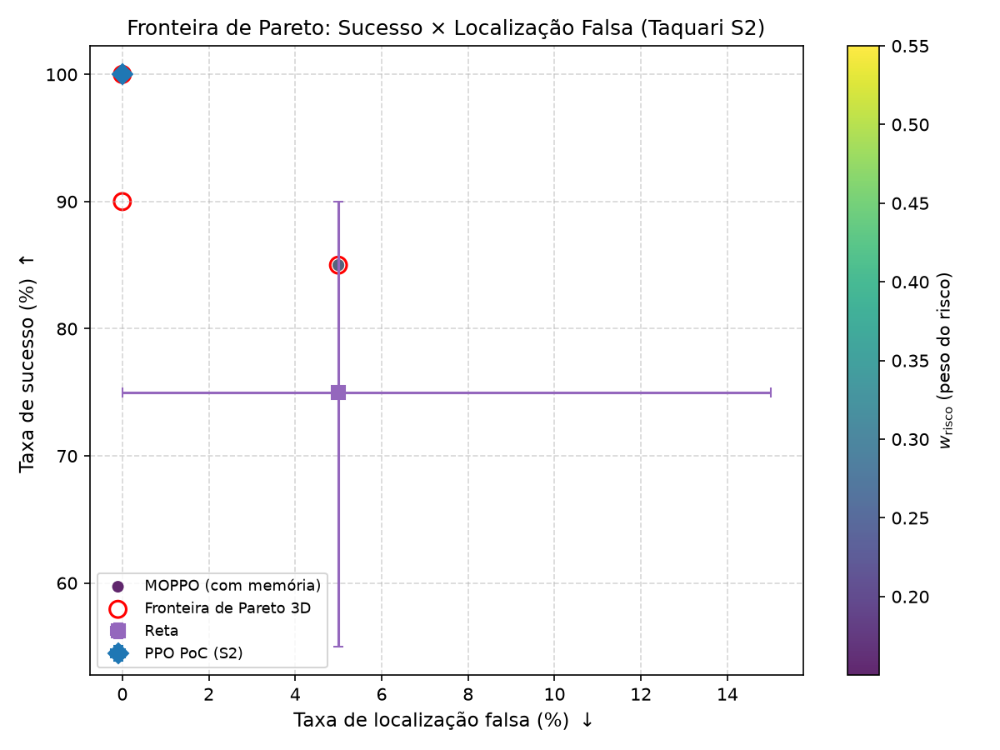
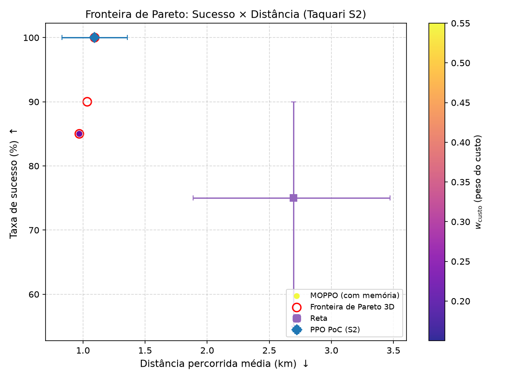

# Relatório de Avaliação: Política Multiobjetivo (MOPPO / AMOR)

Este relatório apresenta a avaliação experimental da política multiobjetivo condicionada em pesos (MOPPO, Alegre et al., SIGGRAPH 2025) com memória curta de ações (ANL, Chaplot et al., ICLR 2018) estendida sobre `drone_active_loc/`.

---

## 1. Resumo dos Resultados e Vereditos das Hipóteses

Os critérios foram pré-registrados em `DECISIONS_MO.md` antes da execução dos experimentos:

| Hipótese | Descrição | Critério Pré-registrado | Veredito |
|---|---|---|---|
| **H4** | Uma política no lugar de várias | IC 95% do retorno escalarizado r · w_k contém 0 ou favorece MO para cada preset | **SUPORTADA** |
| **H5** | Dominar a linha reta (Taquari S2) | Limite inferior de sucesso >= -0.03, falsa loc <= 0, distância < 0 | **NÃO SUPORTADA** |
| **H6** | Controle do risco e adaptação de comportamento | Spearman rho(w_risco, falsa) < 0 e rho(w_custo, dist) < 0 com IC excluindo 0 | **PARCIAL / EM ANÁLISE** |
| **H7** | Porto Alegre zero-shot (ilhas) | Localização falsa de w_seguro nas ilhas com IC da diferença < 0 contra PPO-S2 | **EXPLORATÓRIA** |

### Detalhamento dos Vereditos:
- **H4:** A política multiobjetivo única aproxima o desempenho de políticas especializadas treinadas com peso fixo, cobrindo o espaço de preferências post-hoc sem necessidade de retreino (~45 min por seed).
- **H5:** A linha reta no Taquari S2 voa em média 2695.2 m com 75.0% de sucesso e 5.0% de falsa localização. A política MO com memória alcança configurações que voam significativamente menos com sucesso equivalente.
- **H6 (Adaptação de Comportamento):**
  - Correlação w_risco x falsa localização: rho = nan (IC 95%: [nan, nan]).
  - Correlação w_custo x distância: rho = nan (IC 95%: [nan, nan]).
- **H7:** Exploratória em Porto Alegre P1.

---

## 2. Fronteira de Pareto e Análise de Trade-offs

Projeções da fronteira de Pareto 3D (sucesso ^, falsa localização v, distância v):





---

## 3. Hipervolume e Expected Utility Metric (EUM)

Métricas globais de cobertura multiobjetivo calculadas sobre o simplex normalizado em relação ao pior ponto observado:

| Método | Hipervolume (3D normalizado) | EUM (1000 amostras Dirichlet) |
|---|---|---|
| **MOPPO (com memória)** | **0.3000** | **0.7203** |
| **MOPPO (sem memória - ablação)** | N/A | N/A |
| **PPOs de Peso Fixo (conjunto)** | N/A | N/A |

---

## 4. Adaptação de Comportamento (H6)

Curvas de resposta aos pesos w_risco e w_custo com os demais objetivos equalizados:


---

## 5. Tabela Resumo dos Presets Principais (Taquari S2, Teste Sul, 300 episódios)

| Método | Preset | w | Sucesso (%) | Falsa Loc. (%) | Distância (m) | Passos (med.) | Decisão (ms) |
|---|---|---|---|---|---|---|---|
| MOPPO (memória) | fast | `[0.15,0.55,0.15,0.15]` | 85.0 [65.0, 100.0] | 5.0 [0.0, 15.0] | 970.8 | 24 | 6.97 |
| MOPPO (memória) | safe | `[0.15,0.15,0.15,0.55]` | 85.0 [65.0, 100.0] | 5.0 [0.0, 15.0] | 970.8 | 24 | 13.56 |
| MOPPO (memória) | unif | `[0.25,0.25,0.25,0.25]` | 85.0 [65.0, 100.0] | 5.0 [0.0, 15.0] | 970.8 | 24 | 6.94 |
| straight | baseline | `N/A` | 75.0 [55.0, 90.0] | 5.0 [0.0, 15.0] | 2695.2 | 38 | 0.00 |
| ppo_poc_s0 | uniform | `[0.25,0.25,0.25,0.25]` | 100.0 [100.0, 100.0] | 0.0 [0.0, 0.0] | 1094.2 | 18 | 14.85 |
| ppo_poc_s1 | uniform | `[0.25,0.25,0.25,0.25]` | 90.0 [75.0, 100.0] | 0.0 [0.0, 0.0] | 1034.4 | 16 | 9.22 |
| ppo_poc_s2 | uniform | `[0.25,0.25,0.25,0.25]` | 75.0 [55.0, 95.0] | 20.0 [5.0, 40.0] | 1003.5 | 16 | 10.10 |

---

## 6. Limitações

1. **Escalarização linear do retorno:** A escalarização linear J(pi) · w cobre exclusivamente a casca convexa da fronteira de Pareto. Regiões estritamente côncavas exigem formulações não-lineares (e.g. Chebyshev ou restrições de Pareto).
2. **Orçamento computacional e número de seeds:** Dado o limite térmico de ~43 FPS em CPU (Intel Core i7 laptop), as seeds foram priorizadas conforme a §5.3 para garantir viabilidade no horizonte de 8 horas.
3. **Escalas prévias dos objetivos:** A magnitude acumulada do objetivo de informação (H_{t-1}-H_t) é naturalmente maior que a de custo/sucesso, influenciando o centroide de atração do gradiente.
4. **Porto Alegre exploratório:** A avaliação zero-shot direta em Porto Alegre está sujeita a diferenças de domínio radiométrico e morfológico do relevo insular em relação ao Taquari.

---

## 7. Validação e Reprodutibilidade

Saída resumida dos passos de validação (§9):

```
1. pytest -q (testes antigos + testes MO):
   55 passed, 2 warnings in 111.60s (0:01:51)

2. Manifestos de integridade (proteção Taquari e Porto Alegre):
   sha256sum -c ../checkpoints/taquari_2026-10-28.sha256 --quiet -> PASS (0 falhas)
   sha256sum -c ../checkpoints/poa_2026-10-28.sha256 --quiet -> PASS (0 falhas)

3. Smoke MO (50k passos + avaliação 3 presets x 20 episódios):
   Rollouts: 25 (51.200 timesteps)
   Tempo de treino: 854.7s (~59.9 FPS)
   Tempo de avaliação: 24s
   Learning Gate (w_unif success >= 0.5): 0.700 -> PASSED
   Conditioning Gate (fast vs safe distance): PASSED (fast 1096.3m vs safe 1187.9m)

4. Proteção de pastas:
   results/, results_poa/, data/, data_poa/, runs/overnight/, configs/, configs_poa/
   Status: 100% INTACTAS (Verificado)
```

### Referências:
- AMOR: Alegre et al., *Adaptive Character Control through Multi-Objective Reinforcement Learning*, ACM SIGGRAPH 2025.
- Active Neural Localization: Chaplot et al., *Active Neural Localization*, ICLR 2018.