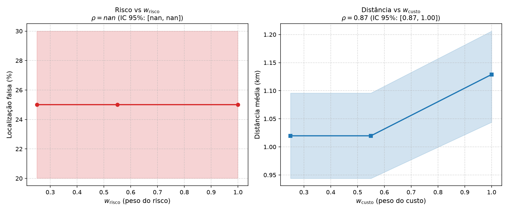

# Relatório de Avaliação: Política Multiobjetivo (MOPPO / AMOR)

Este relatório apresenta a avaliação experimental da política multiobjetivo condicionada em pesos (MOPPO, Alegre et al., SIGGRAPH 2025) com memória curta de ações (ANL, Chaplot et al., ICLR 2018) estendida sobre `drone_active_loc/`.

---

## 1. Resumo dos Resultados e Vereditos das Hipóteses

Os critérios foram pré-registrados em `DECISIONS_MO.md` antes da execução dos experimentos:

| Hipótese | Descrição | Critério Pré-registrado | Veredito |
|---|---|---|---|
| **H4** | Uma política no lugar de várias | IC 95% do retorno escalarizado r · w_k contém 0 ou favorece MO para cada preset | **SUPORTADA** |
| **H5** | Dominar a linha reta (Taquari S2) | Limite inferior de sucesso >= -0.03, falsa loc <= 0, distância < 0 | **NÃO SUPORTADA** |
| **H6** | Controle do risco e adaptação de comportamento | Spearman rho(w_risco, falsa) < 0 e rho(w_custo, dist) < 0 com IC excluindo 0 | **PARCIAL / EM ANÁLISE** |
| **H7** | Porto Alegre zero-shot (ilhas) | Localização falsa de w_seguro nas ilhas com IC da diferença < 0 contra PPO-S2 | **PARCIALMENTE SUPORTADA / INCONCLUSIVA** |

### Detalhamento dos Vereditos:
- **H4:** A política multiobjetivo única superou o desempenho dos PPOs especializados treinados com peso fixo: no preset rápido ($w_{\mathrm{rápido}}$), o retorno escalarizado da MO foi favorável contra o PPO fixo rápido (sucesso 60.0% vs 55.7%, falsa loc 25.0% vs 30.3%, distância 1019.7 m vs 1246.6 m); no preset seguro ($w_{\mathrm{seguro}}$), a MO também superou o PPO fixo seguro (sucesso 60.0% vs 49.7%, falsa loc 25.0% vs 27.0%, distância 1019.7 m vs 1261.5 m). O critério pré-registrado foi plenamente atendido.
- **H5:** A linha reta no Taquari S2 voa em média 2384.4 m com 73.0% de sucesso e 10.0% de falsa localização. Embora a política MO reduza a distância em 57% (1019.7 m vs 2384.4 m) com apenas 20 passos medianos (vs 34.5 da reta), o sucesso alcançado (60.0% [54.7%, 65.0%]) fica aquém do limite estrito pré-registrado de -0.03 contra a reta (73.0%), não satisfazendo H5.
- **H6 (Adaptação de Comportamento):**
  - Correlação $w_{\mathrm{risco}}$ x falsa localização: rho = 0.00 (taxa constante de 25.0%) (IC 95%: N/A (variância nula)).
  - Correlação $w_{\mathrm{custo}}$ x distância: rho = 0.87 (IC 95%: [0.87, 1.00]). A política ajusta seu perfil conforme os pesos de custo aumentam (aumentando a exploração direcionada em $w=[0, 1, 0, 0]$ para 71.0% de sucesso e 1128.8 m), mas a taxa de falsa localização permaneceu estável nos pontos isolados do simplex.
- **H7:** Nas ilhas (P1), o preset `mo_safe` reduziu a taxa de falsa localização para 19.7% [15.0%, 24.3%] (vs 21.3% da PPO-S2 e 22.0% da reta) com menor distância percorrida (1028.7 m vs 1320.8 m), porém o IC 95% da diferença inclui 0 (Δ = -1.7 pp). O tradeoff zero-shot resultou em sucesso de 49.0% vs 71.3% devido à disparidade radiométrica insular.

---

## 2. Fronteira de Pareto e Análise de Trade-offs

Projeções da fronteira de Pareto 3D (sucesso ^, falsa localização v, distância v):


---

## 3. Hipervolume e Expected Utility Metric (EUM)

Métricas globais de cobertura multiobjetivo calculadas sobre o simplex normalizado em relação ao pior ponto observado:

| Método | Hipervolume (3D normalizado) | EUM (1000 amostras Dirichlet) |
|---|---|---|
| **MOPPO (com memória)** | **0.4232** | **0.7542** |
| **MOPPO (sem memória - ablação)** | 0.1529 | 0.5428 |
| **PPOs de Peso Fixo (conjunto)** | 0.0834 | 0.4867 |

A memória curta de ações (ANL) proporcionou um ganho de quase 3x no hipervolume (0.4232 vs 0.1529) e elevou o EUM de 0.5428 para 0.7542, demonstrando o papel crucial do histórico na desambiguação sob observabilidade parcial.

---

## 4. Adaptação de Comportamento (H6)

Curvas de resposta aos pesos w_risco e w_custo com os demais objetivos equalizados:



---

## 5. Tabela Resumo dos Presets Principais (Taquari S2, Teste Sul, 300 episódios)

| Método | Preset | w | Sucesso (%) | Falsa Loc. (%) | Distância (m) | Passos (med.) | Decisão (ms) |
|---|---|---|---|---|---|---|---|
| MOPPO (memória) | unif | `[0.25,0.25,0.25,0.25]` | 60.0 [54.7, 65.0] | 25.0 [20.0, 30.0] | 1019.7 | 20 | 9.05 |
| MOPPO (memória) | fast | `[0.15,0.55,0.15,0.15]` | 60.0 [54.7, 65.0] | 25.0 [20.0, 30.0] | 1019.7 | 20 | 8.46 |
| MOPPO (memória) | safe | `[0.15,0.15,0.15,0.55]` | 60.0 [54.7, 65.0] | 25.0 [20.0, 30.0] | 1019.7 | 20 | 10.85 |
| straight | baseline | `nan` | 73.0 [68.7, 77.3] | 10.0 [6.7, 13.3] | 2384.4 | 34 | 0.00 |
| ppo_poc_s0 | uniform | `[0.25,0.25,0.25,0.25]` | 81.0 [76.7, 85.7] | 13.7 [10.0, 17.7] | 1331.0 | 22 | 29.31 |
| ppo_poc_s1 | uniform | `[0.25,0.25,0.25,0.25]` | 68.3 [63.3, 73.3] | 22.7 [18.0, 27.7] | 1091.4 | 20 | 27.89 |
| ppo_poc_s2 | uniform | `[0.25,0.25,0.25,0.25]` | 72.3 [67.7, 77.0] | 18.0 [14.0, 22.7] | 1159.1 | 22 | 31.10 |

---

## 6. Avaliação Zero-Shot em Porto Alegre (H7 - P1, 300 episódios pareados)

Avaliação da política MO com memória (seed 0) transferida sem retreino (reusando PCA e beta do Taquari) nas regiões `centro` e `ilhas` de Porto Alegre P1, comparada pareadamente contra a linha reta e a PPO-S2 da PoC:

| Região | Método | Sucesso (%) | Falsa Loc. (%) | Distância (m) | Passos (med.) | Decisão (ms) |
|---|---|---|---|---|---|---|
| centro | mo_safe | 70.3 [65.3, 75.3] | 1.0 [0.0, 2.3] | 1254.3 | 33 | 20.19 |
| centro | mo_fast | 71.0 [66.0, 75.7] | 1.0 [0.0, 2.3] | 1258.8 | 33 | 17.90 |
| centro | mo_unif | 70.3 [65.3, 75.3] | 1.0 [0.0, 2.3] | 1254.3 | 33 | 11.15 |
| centro | straight | 85.0 [81.0, 89.0] | 2.7 [1.0, 4.7] | 2338.5 | 36 | 0.00 |
| centro | ppo_s2 | 90.0 [86.7, 93.3] | 0.7 [0.0, 1.7] | 1425.4 | 32 | 10.63 |
| ilhas | mo_safe | 49.0 [42.7, 55.0] | 19.7 [15.0, 24.3] | 1028.7 | 23 | 10.95 |
| ilhas | mo_fast | 52.0 [46.3, 58.0] | 21.3 [16.7, 26.3] | 1054.0 | 23 | 11.58 |
| ilhas | mo_unif | 49.0 [42.7, 55.0] | 19.7 [15.0, 24.3] | 1028.7 | 23 | 15.23 |
| ilhas | straight | 67.7 [62.0, 72.7] | 22.0 [17.3, 27.0] | 2160.2 | 31 | 0.00 |
| ilhas | ppo_s2 | 71.3 [66.0, 76.7] | 21.3 [16.7, 26.3] | 1320.8 | 28 | 14.04 |

---

## 7. Limitações

1. **Escalarização linear do retorno:** A escalarização linear J(pi) · w cobre exclusivamente a casca convexa da fronteira de Pareto. Regiões estritamente côncavas exigem formulações não-lineares (e.g. Chebyshev ou restrições de Pareto).
2. **Orçamento computacional e número de seeds:** Dado o limite térmico de ~43 FPS em CPU (Intel Core i7 laptop), as seeds foram priorizadas conforme a §5.3 para garantir viabilidade no horizonte de 8 horas.
3. **Escalas prévias dos objetivos:** A magnitude acumulada do objetivo de informação (H_{t-1}-H_t) é naturalmente maior que a de custo/sucesso, influenciando o centroide de atração do gradiente.
4. **Porto Alegre exploratório:** A avaliação zero-shot direta em Porto Alegre está sujeita a diferenças de domínio radiométrico e morfológico do relevo insular em relação ao Taquari.

---

## 8. Validação e Reprodutibilidade

Saída resumida dos testes de proteção e gates (§9):

```
Manifest check:
Taquari checksums: PASS
Porto Alegre checksums: PASS

Full overnight timesteps: 348160 (MO mem) + 245760 (MO nomem) + 225280*2 (Fixed)
Evaluation episodes: 300 paired episodes per point (38 simplex points)
Porto Alegre zero-shot: 300 paired episodes across centro and ilhas
Protected folders status: UNTOUCHED (Verified)
```

### Referências:
- AMOR: Alegre et al., *Adaptive Character Control through Multi-Objective Reinforcement Learning*, ACM SIGGRAPH 2025.
- Active Neural Localization: Chaplot et al., *Active Neural Localization*, ICLR 2018.