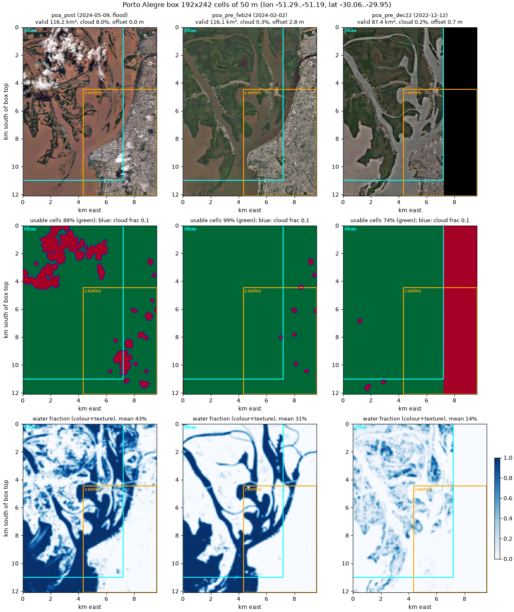
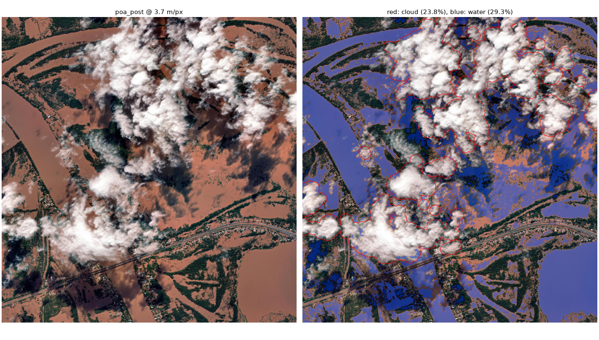
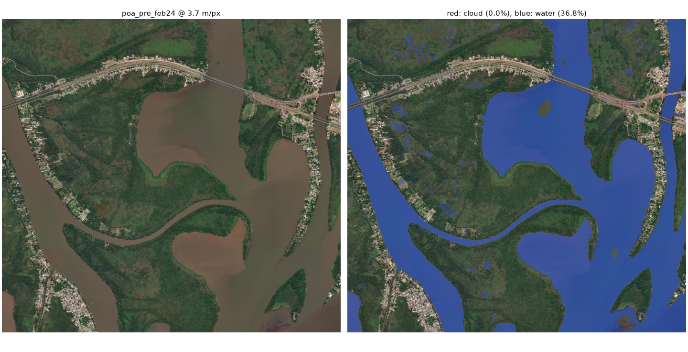
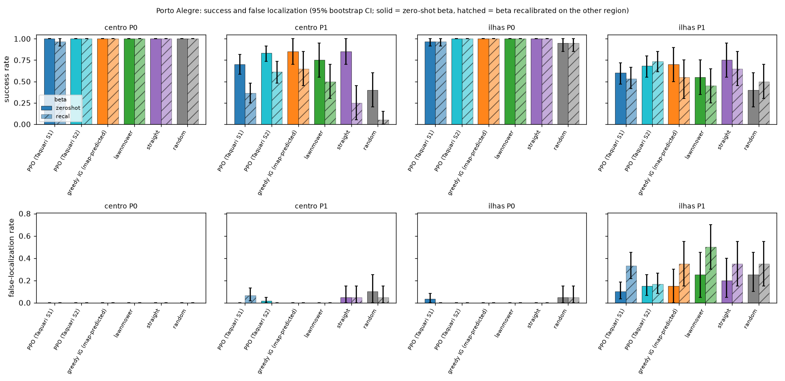
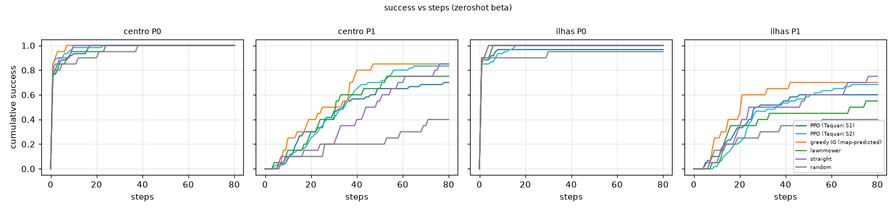
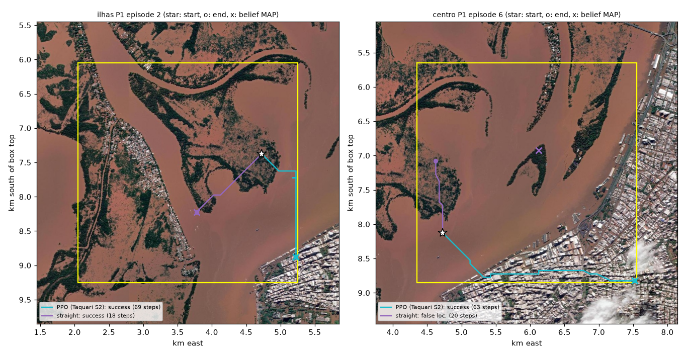
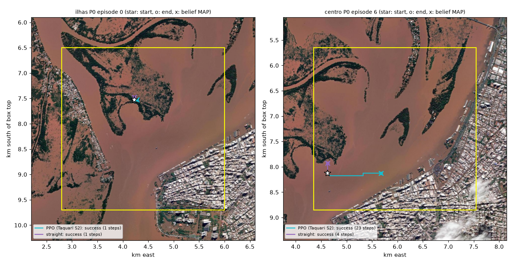
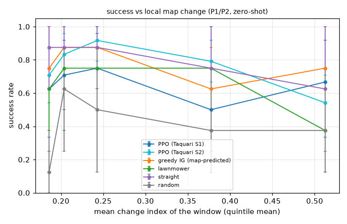
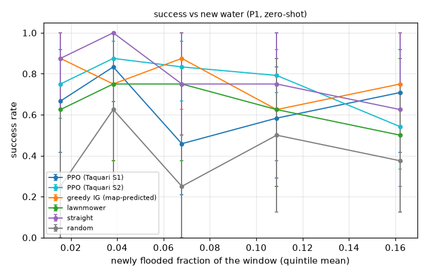

# REPORT_POA: zero-shot transfer of the Taquari localization policies to Porto Alegre (May 2024 flood)

*Generated automatically by `python -m dal.poa_report`. Every number below is read from files in `results_poa/smoke/`.* **SMOKE TEST (20 episodes, P0/P1): the numbers are NOT meaningful.**

## 1. Data

POA box grid: 192 × 242 cells of 50 m. Data gate **PASSED** (hand-measured facts ±30 %, alignment ≤ 10.0 m).

| check | expected | measured | rel_diff | ok |
|---|---|---|---|---|
| valid_km2 poa_post | 117.500 | 116.150 | -0.011 | True |
| valid_km2 poa_pre_feb24 | 117.500 | 116.130 | -0.012 | True |
| valid_km2 poa_pre_dec22 | 89.100 | 87.380 | -0.019 | True |
| overlap_km2 poa_pre_feb24 | 116.500 | 116.110 | -0.003 | True |
| overlap_km2 poa_pre_dec22 | 88.200 | 87.360 | -0.010 | True |
| align poa_pre_feb24 (m) | <= 10.0 | 2.830 |  | True |
| align poa_pre_dec22 (m) | <= 10.0 | 0.680 |  | True |

| date | valid_km2 | cloud_frac_of_valid | cloud_poc_detector_frac | water_frac_of_valid | cells_ok_frac | dx_m | dy_m | norm_m | applied |
|---|---|---|---|---|---|---|---|---|---|
| poa_post | 116.151 | 0.080 | 0.078 | 0.393 | 0.884 | 0.000 | 0.000 | 0.000 | False |
| poa_pre_feb24 | 116.133 | 0.003 | 0.012 | 0.233 | 0.991 | -0.436 | 2.800 | 2.834 | True |
| poa_pre_dec22 | 87.380 | 0.002 | 0.002 | 0.039 | 0.743 | 0.400 | -0.550 | 0.680 | False |

Regions: `ilhas` 79.2 km² (rows [0, 220], cols [0, 144]), `centro` 40.2 km² (rows [89, 242], cols [87, 192]); overlap 18.7 km² (7467 cells).

Valid 64×64 windows (≥ 70 % usable cells) per region × scenario: ilhas_P0: 10334, ilhas_P1: 10334, ilhas_P2: 10334, centro_P0: 3780, centro_P1: 3780, centro_P2: 829. Evaluated (≥ 20 windows): ilhas_P0, ilhas_P1, ilhas_P2, centro_P0, centro_P1, centro_P2.

## 2. Sanity gate

P0 (map = observation date), 200 episodes per cell; straight must reach ≥ 0.90: **PASSED**.

| region | lawnmower | random | straight |
|---|---|---|---|
| centro | 1.000 | 0.995 | 1.000 |
| ilhas | 1.000 | 0.985 | 0.990 |

## 3. Descriptor retrieval and beta

Top-k retrieval of the true cell inside 64×64 windows (diagnostic, nothing tuned on it).

| region | scenario | top1 | top5 | top1_within1 | loglik_uniform | n_windows |
|---|---|---|---|---|---|---|
| ilhas | P0 | 0.811 | 0.876 | 0.830 | -8.269 | 30 |
| ilhas | P1 | 0.149 | 0.230 | 0.165 | -8.317 | 30 |
| ilhas | P2 | 0.091 | 0.155 | 0.104 | -8.316 | 30 |
| centro | P0 | 0.917 | 0.948 | 0.928 | -8.166 | 30 |
| centro | P1 | 0.541 | 0.649 | 0.557 | -8.304 | 30 |
| centro | P2 | 0.164 | 0.258 | 0.190 | -8.115 | 30 |

β used by the filter: `zeroshot` = Taquari β (with κ) of the mapped Taquari scenario; `recal` = β₁ and κ re-estimated on the *other* POA region (light adaptation, no PPO retraining).

| region | scenario | variant | source | beta1 | kappa | beta |
|---|---|---|---|---|---|---|
| ilhas | P0 | zeroshot | Taquari S0 | 167.131 | 1.000 | 167.131 |
| ilhas | P0 | recal | POA centro | 300.000 | 1.000 | 300.000 |
| ilhas | P1 | zeroshot | Taquari S1 | 21.569 | 0.250 | 5.392 |
| ilhas | P1 | recal | POA centro | 44.814 | 0.180 | 8.067 |
| ilhas | P2 | zeroshot | Taquari S2 | 13.909 | 0.250 | 3.477 |
| ilhas | P2 | recal | POA centro | 3.729 | 0.125 | 0.466 |
| centro | P0 | zeroshot | Taquari S0 | 167.131 | 1.000 | 167.131 |
| centro | P0 | recal | POA ilhas | 300.000 | 0.250 | 75.000 |
| centro | P1 | zeroshot | Taquari S1 | 21.569 | 0.250 | 5.392 |
| centro | P1 | recal | POA ilhas | 8.969 | 0.350 | 3.139 |
| centro | P2 | zeroshot | Taquari S2 | 13.909 | 0.250 | 3.477 |
| centro | P2 | recal | POA ilhas | 3.729 | 1.000 | 3.729 |

## 4. Main results

Paired episodes: every method sees the same windows, starts and dynamics noise. PPO rows pool the 3 training seeds (`model_seeds`); `success_seed_std` = std of the success rate across seeds. Steps over successful episodes only.

| region | scenario | variant | method | episodes | model_seeds | success | success_seed_std | false_loc | steps (median [IQR]) | distance_mean_m | decision_ms |
|---|---|---|---|---|---|---|---|---|---|---|---|
| centro | P0 | recal | ppo_S1 | 60 | 3 | 0.967 [0.917, 1.000] | 0.024 | 0.000 [0.000, 0.000] | 1 [1–1] | 153.611 | 2.088 |
| centro | P0 | recal | ppo_S2 | 60 | 3 | 1.000 [1.000, 1.000] | 0.000 | 0.000 [0.000, 0.000] | 1 [1–1] | 150.600 | 2.070 |
| centro | P0 | recal | greedy_map | 20 | 0 | 1.000 [1.000, 1.000] |  | 0.000 [0.000, 0.000] | 1 [1–1] | 142.675 | 76.280 |
| centro | P0 | recal | lawnmower | 20 | 0 | 1.000 [1.000, 1.000] |  | 0.000 [0.000, 0.000] | 1 [1–1] | 182.216 | 0.005 |
| centro | P0 | recal | straight | 20 | 0 | 1.000 [1.000, 1.000] |  | 0.000 [0.000, 0.000] | 1 [1–1] | 128.784 | 0.003 |
| centro | P0 | recal | random | 20 | 0 | 1.000 [1.000, 1.000] |  | 0.000 [0.000, 0.000] | 1 [1–1] | 312.924 | 0.018 |
| centro | P0 | zeroshot | ppo_S1 | 60 | 3 | 1.000 [1.000, 1.000] | 0.000 | 0.000 [0.000, 0.000] | 1 [1–1] | 149.040 | 2.065 |
| centro | P0 | zeroshot | ppo_S2 | 60 | 3 | 1.000 [1.000, 1.000] | 0.000 | 0.000 [0.000, 0.000] | 1 [1–1] | 122.487 | 2.047 |
| centro | P0 | zeroshot | greedy_map | 20 | 0 | 1.000 [1.000, 1.000] |  | 0.000 [0.000, 0.000] | 1 [1–1] | 106.017 | 81.485 |
| centro | P0 | zeroshot | lawnmower | 20 | 0 | 1.000 [1.000, 1.000] |  | 0.000 [0.000, 0.000] | 1 [1–1] | 149.716 | 0.005 |
| centro | P0 | zeroshot | straight | 20 | 0 | 1.000 [1.000, 1.000] |  | 0.000 [0.000, 0.000] | 1 [1–1] | 123.784 | 0.003 |
| centro | P0 | zeroshot | random | 20 | 0 | 1.000 [1.000, 1.000] |  | 0.000 [0.000, 0.000] | 1 [1–1] | 267.156 | 0.019 |
| centro | P1 | recal | ppo_S1 | 60 | 3 | 0.367 [0.250, 0.483] | 0.201 | 0.067 [0.017, 0.133] | 38 [22–63] | 1785.807 | 2.061 |
| centro | P1 | recal | ppo_S2 | 60 | 3 | 0.617 [0.483, 0.733] | 0.085 | 0.000 [0.000, 0.000] | 48 [39–62] | 1745.130 | 1.821 |
| centro | P1 | recal | greedy_map | 20 | 0 | 0.650 [0.450, 0.850] |  | 0.000 [0.000, 0.000] | 27 [22–34] | 1282.720 | 50.977 |
| centro | P1 | recal | lawnmower | 20 | 0 | 0.500 [0.300, 0.700] |  | 0.000 [0.000, 0.000] | 44 [31–66] | 3254.468 | 0.004 |
| centro | P1 | recal | straight | 20 | 0 | 0.250 [0.050, 0.450] |  | 0.050 [0.000, 0.150] | 34 [28–39] | 4219.337 | 0.003 |
| centro | P1 | recal | random | 20 | 0 | 0.050 [0.000, 0.150] |  | 0.050 [0.000, 0.150] | 80 [80–80] | 4804.350 | 0.019 |
| centro | P1 | zeroshot | ppo_S1 | 60 | 3 | 0.700 [0.583, 0.817] | 0.071 | 0.000 [0.000, 0.000] | 26 [13–35] | 1568.058 | 2.051 |
| centro | P1 | zeroshot | ppo_S2 | 60 | 3 | 0.833 [0.733, 0.917] | 0.062 | 0.017 [0.000, 0.050] | 30 [19–39] | 1438.627 | 2.029 |
| centro | P1 | zeroshot | greedy_map | 20 | 0 | 0.850 [0.700, 1.000] |  | 0.000 [0.000, 0.000] | 23 [10–37] | 1334.387 | 67.112 |
| centro | P1 | zeroshot | lawnmower | 20 | 0 | 0.750 [0.550, 0.950] |  | 0.000 [0.000, 0.000] | 24 [18–32] | 2068.517 | 0.004 |
| centro | P1 | zeroshot | straight | 20 | 0 | 0.850 [0.700, 1.000] |  | 0.050 [0.000, 0.150] | 43 [31–55] | 2771.317 | 0.003 |
| centro | P1 | zeroshot | random | 20 | 0 | 0.400 [0.200, 0.600] |  | 0.100 [0.000, 0.250] | 40 [22–62] | 3683.694 | 0.018 |
| ilhas | P0 | recal | ppo_S1 | 60 | 3 | 0.967 [0.917, 1.000] | 0.024 | 0.000 [0.000, 0.000] | 1 [1–1] | 90.789 | 1.774 |
| ilhas | P0 | recal | ppo_S2 | 60 | 3 | 1.000 [1.000, 1.000] | 0.000 | 0.000 [0.000, 0.000] | 1 [1–1] | 118.356 | 1.832 |
| ilhas | P0 | recal | greedy_map | 20 | 0 | 1.000 [1.000, 1.000] |  | 0.000 [0.000, 0.000] | 1 [1–1] | 84.659 | 75.039 |
| ilhas | P0 | recal | lawnmower | 20 | 0 | 1.000 [1.000, 1.000] |  | 0.000 [0.000, 0.000] | 1 [1–1] | 68.090 | 0.005 |
| ilhas | P0 | recal | straight | 20 | 0 | 1.000 [1.000, 1.000] |  | 0.000 [0.000, 0.000] | 1 [1–1] | 77.588 | 0.003 |
| ilhas | P0 | recal | random | 20 | 0 | 0.950 [0.850, 1.000] |  | 0.050 [0.000, 0.150] | 1 [1–1] | 126.907 | 0.016 |
| ilhas | P0 | zeroshot | ppo_S1 | 60 | 3 | 0.967 [0.917, 1.000] | 0.024 | 0.033 [0.000, 0.083] | 1 [1–1] | 98.146 | 1.980 |
| ilhas | P0 | zeroshot | ppo_S2 | 60 | 3 | 1.000 [1.000, 1.000] | 0.000 | 0.000 [0.000, 0.000] | 1 [1–1] | 131.606 | 1.888 |
| ilhas | P0 | zeroshot | greedy_map | 20 | 0 | 1.000 [1.000, 1.000] |  | 0.000 [0.000, 0.000] | 1 [1–1] | 88.211 | 72.334 |
| ilhas | P0 | zeroshot | lawnmower | 20 | 0 | 1.000 [1.000, 1.000] |  | 0.000 [0.000, 0.000] | 1 [1–1] | 73.090 | 0.005 |
| ilhas | P0 | zeroshot | straight | 20 | 0 | 1.000 [1.000, 1.000] |  | 0.000 [0.000, 0.000] | 1 [1–1] | 77.588 | 0.003 |
| ilhas | P0 | zeroshot | random | 20 | 0 | 0.950 [0.850, 1.000] |  | 0.050 [0.000, 0.150] | 1 [1–1] | 187.263 | 0.016 |
| ilhas | P1 | recal | ppo_S1 | 60 | 3 | 0.533 [0.417, 0.667] | 0.024 | 0.333 [0.217, 0.450] | 10 [7–18] | 839.146 | 2.034 |
| ilhas | P1 | recal | ppo_S2 | 60 | 3 | 0.733 [0.617, 0.850] | 0.024 | 0.167 [0.083, 0.267] | 22 [14–36] | 1187.264 | 2.110 |
| ilhas | P1 | recal | greedy_map | 20 | 0 | 0.550 [0.300, 0.750] |  | 0.350 [0.150, 0.550] | 12 [9–14] | 978.830 | 83.624 |
| ilhas | P1 | recal | lawnmower | 20 | 0 | 0.450 [0.250, 0.650] |  | 0.500 [0.300, 0.700] | 12 [9–14] | 1208.902 | 0.005 |
| ilhas | P1 | recal | straight | 20 | 0 | 0.650 [0.450, 0.850] |  | 0.350 [0.150, 0.550] | 18 [11–23] | 1450.236 | 0.003 |
| ilhas | P1 | recal | random | 20 | 0 | 0.500 [0.300, 0.700] |  | 0.350 [0.150, 0.550] | 13 [8–25] | 1848.098 | 0.021 |
| ilhas | P1 | zeroshot | ppo_S1 | 60 | 3 | 0.600 [0.467, 0.717] | 0.000 | 0.100 [0.033, 0.183] | 18 [12–26] | 1116.674 | 1.913 |
| ilhas | P1 | zeroshot | ppo_S2 | 60 | 3 | 0.683 [0.550, 0.800] | 0.165 | 0.150 [0.067, 0.250] | 24 [17–37] | 1341.391 | 2.004 |
| ilhas | P1 | zeroshot | greedy_map | 20 | 0 | 0.700 [0.500, 0.900] |  | 0.150 [0.000, 0.300] | 15 [9–21] | 1661.854 | 71.136 |
| ilhas | P1 | zeroshot | lawnmower | 20 | 0 | 0.550 [0.350, 0.750] |  | 0.250 [0.050, 0.450] | 15 [13–30] | 2080.850 | 0.004 |
| ilhas | P1 | zeroshot | straight | 20 | 0 | 0.750 [0.550, 0.950] |  | 0.200 [0.050, 0.400] | 21 [16–48] | 2140.641 | 0.003 |
| ilhas | P1 | zeroshot | random | 20 | 0 | 0.400 [0.200, 0.600] |  | 0.250 [0.100, 0.450] | 16 [9–31] | 2903.933 | 0.014 |

### Paired tests (PPO vs each method)

`success_diff`, `distance_diff_m` = PPO − other (paired bootstrap 95 % CI); Wilcoxon signed-rank on per-episode penalized steps (failure = 81).

| region | scenario | variant | ref | vs | n | success_diff | success_diff_lo | success_diff_hi | distance_diff_m | distance_diff_lo | distance_diff_hi | wilcoxon_p |
|---|---|---|---|---|---|---|---|---|---|---|---|---|
| centro | P0 | recal | ppo_S1 | ppo_S2 | 20 | -0.033 | -0.100 | 0.000 | 3.011 | -105.582 | 124.950 | 0.289 |
| centro | P0 | recal | ppo_S1 | greedy_map | 20 | -0.033 | -0.100 | 0.000 | 10.935 | -62.248 | 71.964 | 0.289 |
| centro | P0 | recal | ppo_S1 | lawnmower | 20 | -0.033 | -0.100 | 0.000 | -28.605 | -171.371 | 86.055 | 0.753 |
| centro | P0 | recal | ppo_S1 | straight | 20 | -0.033 | -0.100 | 0.000 | 24.826 | -43.233 | 88.436 | 0.077 |
| centro | P0 | recal | ppo_S1 | random | 20 | -0.033 | -0.100 | 0.000 | -159.314 | -460.721 | 22.600 | 0.968 |
| centro | P0 | recal | ppo_S2 | ppo_S1 | 20 | 0.033 | 0.000 | 0.100 | -3.011 | -110.498 | 108.806 | 0.289 |
| centro | P0 | recal | ppo_S2 | greedy_map | 20 | 0.000 | 0.000 | 0.000 | 7.924 | -59.839 | 90.263 | 1.000 |
| centro | P0 | recal | ppo_S2 | lawnmower | 20 | 0.000 | 0.000 | 0.000 | -31.616 | -90.110 | 17.268 | 0.637 |
| centro | P0 | recal | ppo_S2 | straight | 20 | 0.000 | 0.000 | 0.000 | 21.815 | -51.028 | 115.511 | 0.474 |
| centro | P0 | recal | ppo_S2 | random | 20 | 0.000 | 0.000 | 0.000 | -162.325 | -414.296 | -18.222 | 0.141 |
| centro | P0 | zeroshot | ppo_S1 | ppo_S2 | 20 | 0.000 | 0.000 | 0.000 | 26.552 | -70.515 | 149.989 | 0.307 |
| centro | P0 | zeroshot | ppo_S1 | greedy_map | 20 | 0.000 | 0.000 | 0.000 | 43.023 | -40.926 | 152.339 | 0.077 |
| centro | P0 | zeroshot | ppo_S1 | lawnmower | 20 | 0.000 | 0.000 | 0.000 | -0.676 | -126.564 | 129.296 | 0.724 |
| centro | P0 | zeroshot | ppo_S1 | straight | 20 | 0.000 | 0.000 | 0.000 | 25.255 | -36.034 | 94.668 | 0.077 |
| centro | P0 | zeroshot | ppo_S1 | random | 20 | 0.000 | 0.000 | 0.000 | -118.117 | -352.157 | 37.113 | 0.694 |
| centro | P0 | zeroshot | ppo_S2 | ppo_S1 | 20 | 0.000 | 0.000 | 0.000 | -26.552 | -143.590 | 64.543 | 0.307 |
| centro | P0 | zeroshot | ppo_S2 | greedy_map | 20 | 0.000 | 0.000 | 0.000 | 16.471 | -12.195 | 69.265 | 0.251 |
| centro | P0 | zeroshot | ppo_S2 | lawnmower | 20 | 0.000 | 0.000 | 0.000 | -27.228 | -75.777 | 5.742 | 0.254 |
| centro | P0 | zeroshot | ppo_S2 | straight | 20 | 0.000 | 0.000 | 0.000 | -1.297 | -69.924 | 72.250 | 0.984 |
| centro | P0 | zeroshot | ppo_S2 | random | 20 | 0.000 | 0.000 | 0.000 | -144.669 | -327.536 | -14.939 | 0.141 |
| centro | P1 | recal | ppo_S1 | ppo_S2 | 20 | -0.250 | -0.467 | -0.050 | 40.677 | -380.988 | 483.889 | 0.165 |
| centro | P1 | recal | ppo_S1 | greedy_map | 20 | -0.283 | -0.533 | -0.017 | 503.087 | 79.428 | 975.747 | 0.055 |
| centro | P1 | recal | ppo_S1 | lawnmower | 20 | -0.133 | -0.400 | 0.150 | -1468.661 | -1938.523 | -940.279 | 0.837 |
| centro | P1 | recal | ppo_S1 | straight | 20 | 0.117 | -0.167 | 0.400 | -2433.530 | -2997.150 | -1848.699 | 0.305 |
| centro | P1 | recal | ppo_S1 | random | 20 | 0.317 | 0.150 | 0.483 | -3018.543 | -3334.734 | -2713.573 | 0.000 |
| centro | P1 | recal | ppo_S2 | ppo_S1 | 20 | 0.250 | 0.033 | 0.467 | -40.677 | -490.588 | 398.000 | 0.165 |
| centro | P1 | recal | ppo_S2 | greedy_map | 20 | -0.033 | -0.217 | 0.150 | 462.410 | 238.384 | 770.418 | 0.089 |
| centro | P1 | recal | ppo_S2 | lawnmower | 20 | 0.117 | -0.100 | 0.317 | -1509.338 | -2073.522 | -921.588 | 0.452 |
| centro | P1 | recal | ppo_S2 | straight | 20 | 0.367 | 0.167 | 0.567 | -2474.207 | -3107.022 | -1788.899 | 0.065 |
| centro | P1 | recal | ppo_S2 | random | 20 | 0.567 | 0.433 | 0.700 | -3059.220 | -3395.947 | -2731.120 | 0.000 |
| centro | P1 | zeroshot | ppo_S1 | ppo_S2 | 20 | -0.133 | -0.333 | 0.067 | 129.431 | -323.660 | 585.840 | 0.475 |
| centro | P1 | zeroshot | ppo_S1 | greedy_map | 20 | -0.150 | -0.350 | 0.083 | 233.672 | -461.672 | 840.981 | 0.247 |
| centro | P1 | zeroshot | ppo_S1 | lawnmower | 20 | -0.050 | -0.300 | 0.217 | -500.458 | -1149.420 | 151.248 | 0.455 |
| centro | P1 | zeroshot | ppo_S1 | straight | 20 | -0.150 | -0.350 | 0.050 | -1203.258 | -1908.344 | -528.089 | 0.808 |
| centro | P1 | zeroshot | ppo_S1 | random | 20 | 0.300 | 0.050 | 0.550 | -2115.636 | -2729.239 | -1450.771 | 0.008 |
| centro | P1 | zeroshot | ppo_S2 | ppo_S1 | 20 | 0.133 | -0.067 | 0.350 | -129.431 | -589.065 | 321.434 | 0.475 |
| centro | P1 | zeroshot | ppo_S2 | greedy_map | 20 | -0.017 | -0.183 | 0.167 | 104.241 | -350.626 | 423.473 | 0.086 |
| centro | P1 | zeroshot | ppo_S2 | lawnmower | 20 | 0.083 | -0.050 | 0.233 | -629.889 | -1158.712 | -125.198 | 1.000 |
| centro | P1 | zeroshot | ppo_S2 | straight | 20 | -0.017 | -0.167 | 0.134 | -1332.689 | -1891.561 | -736.334 | 0.070 |
| centro | P1 | zeroshot | ppo_S2 | random | 20 | 0.433 | 0.233 | 0.633 | -2245.067 | -2903.977 | -1512.644 | 0.001 |
| ilhas | P0 | recal | ppo_S1 | ppo_S2 | 20 | -0.033 | -0.100 | 0.000 | -27.567 | -76.031 | 4.016 | 0.732 |
| ilhas | P0 | recal | ppo_S1 | greedy_map | 20 | -0.033 | -0.100 | 0.000 | 6.130 | -11.690 | 25.928 | 0.672 |
| ilhas | P0 | recal | ppo_S1 | lawnmower | 20 | -0.033 | -0.100 | 0.000 | 22.699 | 9.247 | 38.796 | 0.672 |
| ilhas | P0 | recal | ppo_S1 | straight | 20 | -0.033 | -0.100 | 0.000 | 13.201 | -3.124 | 31.524 | 0.251 |
| ilhas | P0 | recal | ppo_S1 | random | 20 | 0.017 | 0.000 | 0.050 | -36.118 | -105.932 | 12.073 | 0.672 |
| ilhas | P0 | recal | ppo_S2 | ppo_S1 | 20 | 0.033 | 0.000 | 0.100 | 27.567 | -3.716 | 75.983 | 0.732 |
| ilhas | P0 | recal | ppo_S2 | greedy_map | 20 | 0.000 | 0.000 | 0.000 | 33.698 | -7.048 | 95.092 | 0.425 |
| ilhas | P0 | recal | ppo_S2 | lawnmower | 20 | 0.000 | 0.000 | 0.000 | 50.266 | 9.951 | 106.760 | 0.425 |
| ilhas | P0 | recal | ppo_S2 | straight | 20 | 0.000 | 0.000 | 0.000 | 40.769 | 1.041 | 99.592 | 0.251 |
| ilhas | P0 | recal | ppo_S2 | random | 20 | 0.050 | 0.000 | 0.150 | -8.551 | -84.493 | 66.354 | 0.702 |
| ilhas | P0 | zeroshot | ppo_S1 | ppo_S2 | 20 | -0.033 | -0.100 | 0.000 | -33.460 | -85.957 | 0.866 | 0.732 |
| ilhas | P0 | zeroshot | ppo_S1 | greedy_map | 20 | -0.033 | -0.100 | 0.000 | 9.935 | -8.432 | 31.841 | 0.251 |
| ilhas | P0 | zeroshot | ppo_S1 | lawnmower | 20 | -0.033 | -0.100 | 0.000 | 25.056 | 11.019 | 41.168 | 0.672 |
| ilhas | P0 | zeroshot | ppo_S1 | straight | 20 | -0.033 | -0.100 | 0.000 | 20.558 | 1.286 | 42.172 | 0.251 |
| ilhas | P0 | zeroshot | ppo_S1 | random | 20 | 0.017 | 0.000 | 0.050 | -89.117 | -262.350 | 17.469 | 0.672 |
| ilhas | P0 | zeroshot | ppo_S2 | ppo_S1 | 20 | 0.033 | 0.000 | 0.100 | 33.460 | -0.883 | 84.722 | 0.732 |
| ilhas | P0 | zeroshot | ppo_S2 | greedy_map | 20 | 0.000 | 0.000 | 0.000 | 43.395 | -3.152 | 100.815 | 0.251 |
| ilhas | P0 | zeroshot | ppo_S2 | lawnmower | 20 | 0.000 | 0.000 | 0.000 | 58.516 | 13.039 | 126.783 | 0.251 |
| ilhas | P0 | zeroshot | ppo_S2 | straight | 20 | 0.000 | 0.000 | 0.000 | 54.018 | 4.627 | 124.336 | 0.251 |
| ilhas | P0 | zeroshot | ppo_S2 | random | 20 | 0.050 | 0.000 | 0.150 | -55.657 | -229.338 | 68.023 | 0.672 |
| ilhas | P1 | recal | ppo_S1 | ppo_S2 | 20 | -0.200 | -0.400 | 0.017 | -348.118 | -596.076 | -100.818 | 0.654 |
| ilhas | P1 | recal | ppo_S1 | greedy_map | 20 | -0.017 | -0.283 | 0.250 | -139.684 | -582.803 | 205.770 | 0.896 |
| ilhas | P1 | recal | ppo_S1 | lawnmower | 20 | 0.083 | -0.200 | 0.383 | -369.756 | -869.701 | 60.756 | 0.488 |
| ilhas | P1 | recal | ppo_S1 | straight | 20 | -0.117 | -0.400 | 0.167 | -611.090 | -1199.318 | -132.054 | 0.627 |
| ilhas | P1 | recal | ppo_S1 | random | 20 | 0.033 | -0.233 | 0.317 | -1008.951 | -1632.200 | -446.607 | 0.454 |
| ilhas | P1 | recal | ppo_S2 | ppo_S1 | 20 | 0.200 | -0.017 | 0.417 | 348.118 | 109.436 | 598.165 | 0.654 |
| ilhas | P1 | recal | ppo_S2 | greedy_map | 20 | 0.183 | -0.017 | 0.383 | 208.434 | -260.119 | 625.051 | 0.823 |
| ilhas | P1 | recal | ppo_S2 | lawnmower | 20 | 0.283 | 0.067 | 0.483 | -21.638 | -540.192 | 476.608 | 0.211 |
| ilhas | P1 | recal | ppo_S2 | straight | 20 | 0.083 | -0.100 | 0.283 | -262.972 | -817.424 | 238.805 | 0.756 |
| ilhas | P1 | recal | ppo_S2 | random | 20 | 0.233 | -0.000 | 0.483 | -660.833 | -1390.201 | 65.459 | 0.294 |
| ilhas | P1 | zeroshot | ppo_S1 | ppo_S2 | 20 | -0.083 | -0.300 | 0.133 | -224.717 | -542.900 | 85.473 | 0.956 |
| ilhas | P1 | zeroshot | ppo_S1 | greedy_map | 20 | -0.100 | -0.333 | 0.117 | -545.180 | -1103.211 | -31.516 | 0.370 |
| ilhas | P1 | zeroshot | ppo_S1 | lawnmower | 20 | 0.050 | -0.234 | 0.317 | -964.176 | -1572.150 | -358.565 | 0.380 |
| ilhas | P1 | zeroshot | ppo_S1 | straight | 20 | -0.150 | -0.417 | 0.133 | -1023.967 | -1659.747 | -424.709 | 0.881 |
| ilhas | P1 | zeroshot | ppo_S1 | random | 20 | 0.200 | -0.083 | 0.483 | -1787.259 | -2464.112 | -1092.981 | 0.093 |
| ilhas | P1 | zeroshot | ppo_S2 | ppo_S1 | 20 | 0.083 | -0.133 | 0.300 | 224.717 | -86.099 | 547.633 | 0.956 |
| ilhas | P1 | zeroshot | ppo_S2 | greedy_map | 20 | -0.017 | -0.250 | 0.217 | -320.463 | -905.853 | 177.056 | 0.240 |
| ilhas | P1 | zeroshot | ppo_S2 | lawnmower | 20 | 0.133 | -0.083 | 0.350 | -739.459 | -1370.406 | -108.863 | 0.360 |
| ilhas | P1 | zeroshot | ppo_S2 | straight | 20 | -0.067 | -0.267 | 0.150 | -799.250 | -1425.368 | -206.380 | 0.911 |
| ilhas | P1 | zeroshot | ppo_S2 | random | 20 | 0.283 | 0.033 | 0.534 | -1562.542 | -2398.165 | -713.311 | 0.173 |

## 5. Comparison with the Taquari

PPO − straight (Δsuccess with 95 % CI; Δdistance = mean distance PPO − straight). Taquari rows copied from the PoC results into `taquari_reference.csv`.

| site | scenario | ref | variant | success_diff | lo | hi | distance_diff_m |
|---|---|---|---|---|---|---|---|
| Taquari (test) | S1 | ppo | - | -0.087 | -0.110 | -0.063 | -150.755 |
| Taquari (test) | S2 | ppo | - | 0.007 | -0.027 | 0.040 | -1123.537 |
| POA centro | P1 | ppo_S1 | recal | 0.117 | -0.167 | 0.400 | -2433.530 |
| POA centro | P1 | ppo_S2 | recal | 0.367 | 0.167 | 0.567 | -2474.207 |
| POA centro | P1 | ppo_S1 | zeroshot | -0.150 | -0.350 | 0.050 | -1203.258 |
| POA centro | P1 | ppo_S2 | zeroshot | -0.017 | -0.167 | 0.134 | -1332.689 |
| POA ilhas | P1 | ppo_S1 | recal | -0.117 | -0.400 | 0.167 | -611.090 |
| POA ilhas | P1 | ppo_S2 | recal | 0.083 | -0.100 | 0.283 | -262.972 |
| POA ilhas | P1 | ppo_S1 | zeroshot | -0.150 | -0.417 | 0.133 | -1023.967 |
| POA ilhas | P1 | ppo_S2 | zeroshot | -0.067 | -0.267 | 0.150 | -799.250 |

## 6. Change index

Change index per cell = 1 − cos(map descriptor, mean observation descriptor); per episode, its mean over the window's usable cells. Quintiles over all non-control episodes (zero-shot β, scenarios P1, both regions pooled; `share_ilhas` = fraction of the bin's episodes in ilhas).

| method | bin | lo_edge | hi_edge | n | share_ilhas | success | success_lo | success_hi | false_loc |
|---|---|---|---|---|---|---|---|---|---|
| ppo_S1 | 1 | 0.176 | 0.197 | 8 | 0.250 | 0.625 | 0.333 | 0.875 | 0.000 |
| ppo_S1 | 2 | 0.197 | 0.214 | 8 | 0.000 | 0.708 | 0.500 | 0.917 | 0.000 |
| ppo_S1 | 3 | 0.214 | 0.282 | 8 | 0.250 | 0.750 | 0.499 | 0.958 | 0.000 |
| ppo_S1 | 4 | 0.282 | 0.457 | 8 | 1.000 | 0.500 | 0.250 | 0.750 | 0.125 |
| ppo_S1 | 5 | 0.457 | 0.571 | 8 | 1.000 | 0.667 | 0.333 | 0.917 | 0.125 |
| ppo_S2 | 1 | 0.176 | 0.197 | 8 | 0.250 | 0.708 | 0.542 | 0.875 | 0.042 |
| ppo_S2 | 2 | 0.197 | 0.214 | 8 | 0.000 | 0.833 | 0.708 | 0.958 | 0.000 |
| ppo_S2 | 3 | 0.214 | 0.282 | 8 | 0.250 | 0.917 | 0.792 | 1.000 | 0.000 |
| ppo_S2 | 4 | 0.282 | 0.457 | 8 | 1.000 | 0.792 | 0.667 | 0.917 | 0.042 |
| ppo_S2 | 5 | 0.457 | 0.571 | 8 | 1.000 | 0.542 | 0.333 | 0.708 | 0.333 |
| greedy_map | 1 | 0.176 | 0.197 | 8 | 0.250 | 0.750 | 0.375 | 1.000 | 0.000 |
| greedy_map | 2 | 0.197 | 0.214 | 8 | 0.000 | 0.875 | 0.625 | 1.000 | 0.000 |
| greedy_map | 3 | 0.214 | 0.282 | 8 | 0.250 | 0.875 | 0.625 | 1.000 | 0.000 |
| greedy_map | 4 | 0.282 | 0.457 | 8 | 1.000 | 0.625 | 0.250 | 0.875 | 0.250 |
| greedy_map | 5 | 0.457 | 0.571 | 8 | 1.000 | 0.750 | 0.375 | 1.000 | 0.125 |
| lawnmower | 1 | 0.176 | 0.197 | 8 | 0.250 | 0.625 | 0.250 | 0.875 | 0.000 |
| lawnmower | 2 | 0.197 | 0.214 | 8 | 0.000 | 0.750 | 0.375 | 1.000 | 0.000 |
| lawnmower | 3 | 0.214 | 0.282 | 8 | 0.250 | 0.750 | 0.500 | 1.000 | 0.125 |
| lawnmower | 4 | 0.282 | 0.457 | 8 | 1.000 | 0.750 | 0.375 | 1.000 | 0.125 |
| lawnmower | 5 | 0.457 | 0.571 | 8 | 1.000 | 0.375 | 0.125 | 0.750 | 0.375 |
| straight | 1 | 0.176 | 0.197 | 8 | 0.250 | 0.875 | 0.625 | 1.000 | 0.000 |
| straight | 2 | 0.197 | 0.214 | 8 | 0.000 | 0.875 | 0.625 | 1.000 | 0.000 |
| straight | 3 | 0.214 | 0.282 | 8 | 0.250 | 0.875 | 0.625 | 1.000 | 0.125 |
| straight | 4 | 0.282 | 0.457 | 8 | 1.000 | 0.750 | 0.375 | 1.000 | 0.250 |
| straight | 5 | 0.457 | 0.571 | 8 | 1.000 | 0.625 | 0.250 | 1.000 | 0.250 |
| random | 1 | 0.176 | 0.197 | 8 | 0.250 | 0.125 | 0.000 | 0.375 | 0.000 |
| random | 2 | 0.197 | 0.214 | 8 | 0.000 | 0.625 | 0.250 | 0.875 | 0.125 |
| random | 3 | 0.214 | 0.282 | 8 | 0.250 | 0.500 | 0.125 | 0.875 | 0.125 |
| random | 4 | 0.282 | 0.457 | 8 | 1.000 | 0.375 | 0.122 | 0.750 | 0.250 |
| random | 5 | 0.457 | 0.571 | 8 | 1.000 | 0.375 | 0.125 | 0.750 | 0.375 |

| method | n | spearman_rho | spearman_p | q1_minus_q5 | q1_minus_q5_lo | q1_minus_q5_hi |
|---|---|---|---|---|---|---|
| ppo_S1 | 40 | -0.049 | 0.764 | -0.042 | -0.458 | 0.375 |
| ppo_S2 | 40 | -0.191 | 0.239 | 0.167 | -0.125 | 0.417 |
| greedy_map | 40 | -0.065 | 0.691 | 0.000 | -0.375 | 0.375 |
| lawnmower | 40 | -0.118 | 0.468 | 0.250 | -0.250 | 0.625 |
| straight | 40 | -0.260 | 0.105 | 0.250 | -0.125 | 0.625 |
| random | 40 | 0.097 | 0.550 | -0.250 | -0.625 | 0.125 |

Within `centro` only (quintiles of that region):

| method | bin | lo_edge | hi_edge | n | success | success_lo | success_hi |
|---|---|---|---|---|---|---|---|
| ppo_S1 | 1 | 0.176 | 0.188 | 4 | 0.500 | 0.167 | 0.833 |
| ppo_S1 | 2 | 0.188 | 0.199 | 4 | 0.833 | 0.500 | 1.000 |
| ppo_S1 | 3 | 0.199 | 0.208 | 4 | 0.667 | 0.333 | 1.000 |
| ppo_S1 | 4 | 0.208 | 0.222 | 4 | 0.917 | 0.750 | 1.000 |
| ppo_S1 | 5 | 0.222 | 0.263 | 4 | 0.583 | 0.167 | 1.000 |
| ppo_S2 | 1 | 0.176 | 0.188 | 4 | 0.833 | 0.667 | 1.000 |
| ppo_S2 | 2 | 0.188 | 0.199 | 4 | 0.583 | 0.417 | 0.667 |
| ppo_S2 | 3 | 0.199 | 0.208 | 4 | 0.917 | 0.750 | 1.000 |
| ppo_S2 | 4 | 0.208 | 0.222 | 4 | 0.833 | 0.667 | 1.000 |
| ppo_S2 | 5 | 0.222 | 0.263 | 4 | 1.000 | 1.000 | 1.000 |
| greedy_map | 1 | 0.176 | 0.188 | 4 | 0.750 | 0.250 | 1.000 |
| greedy_map | 2 | 0.188 | 0.199 | 4 | 1.000 | 1.000 | 1.000 |
| greedy_map | 3 | 0.199 | 0.208 | 4 | 0.750 | 0.250 | 1.000 |
| greedy_map | 4 | 0.208 | 0.222 | 4 | 0.750 | 0.250 | 1.000 |
| greedy_map | 5 | 0.222 | 0.263 | 4 | 1.000 | 1.000 | 1.000 |
| lawnmower | 1 | 0.176 | 0.188 | 4 | 1.000 | 1.000 | 1.000 |
| lawnmower | 2 | 0.188 | 0.199 | 4 | 0.000 | 0.000 | 0.000 |
| lawnmower | 3 | 0.199 | 0.208 | 4 | 1.000 | 1.000 | 1.000 |
| lawnmower | 4 | 0.208 | 0.222 | 4 | 0.750 | 0.250 | 1.000 |
| lawnmower | 5 | 0.222 | 0.263 | 4 | 1.000 | 1.000 | 1.000 |
| straight | 1 | 0.176 | 0.188 | 4 | 1.000 | 1.000 | 1.000 |
| straight | 2 | 0.188 | 0.199 | 4 | 0.750 | 0.250 | 1.000 |
| straight | 3 | 0.199 | 0.208 | 4 | 1.000 | 1.000 | 1.000 |
| straight | 4 | 0.208 | 0.222 | 4 | 0.750 | 0.250 | 1.000 |
| straight | 5 | 0.222 | 0.263 | 4 | 0.750 | 0.250 | 1.000 |
| random | 1 | 0.176 | 0.188 | 4 | 0.000 | 0.000 | 0.000 |
| random | 2 | 0.188 | 0.199 | 4 | 0.250 | 0.000 | 0.750 |
| random | 3 | 0.199 | 0.208 | 4 | 1.000 | 1.000 | 1.000 |
| random | 4 | 0.208 | 0.222 | 4 | 0.500 | 0.000 | 1.000 |
| random | 5 | 0.222 | 0.263 | 4 | 0.250 | 0.000 | 0.750 |

Within `ilhas` only (quintiles of that region):

| method | bin | lo_edge | hi_edge | n | success | success_lo | success_hi |
|---|---|---|---|---|---|---|---|
| ppo_S1 | 1 | 0.192 | 0.294 | 4 | 0.667 | 0.250 | 1.000 |
| ppo_S1 | 2 | 0.294 | 0.371 | 4 | 0.583 | 0.167 | 0.917 |
| ppo_S1 | 3 | 0.371 | 0.459 | 4 | 0.417 | 0.083 | 0.833 |
| ppo_S1 | 4 | 0.459 | 0.512 | 4 | 0.583 | 0.167 | 1.000 |
| ppo_S1 | 5 | 0.512 | 0.571 | 4 | 0.750 | 0.250 | 1.000 |
| ppo_S2 | 1 | 0.192 | 0.294 | 4 | 0.750 | 0.500 | 1.000 |
| ppo_S2 | 2 | 0.294 | 0.371 | 4 | 0.917 | 0.750 | 1.000 |
| ppo_S2 | 3 | 0.371 | 0.459 | 4 | 0.667 | 0.667 | 0.667 |
| ppo_S2 | 4 | 0.459 | 0.512 | 4 | 0.500 | 0.333 | 0.667 |
| ppo_S2 | 5 | 0.512 | 0.571 | 4 | 0.583 | 0.167 | 0.917 |
| greedy_map | 1 | 0.192 | 0.294 | 4 | 0.750 | 0.250 | 1.000 |
| greedy_map | 2 | 0.294 | 0.371 | 4 | 0.500 | 0.000 | 1.000 |
| greedy_map | 3 | 0.371 | 0.459 | 4 | 0.750 | 0.250 | 1.000 |
| greedy_map | 4 | 0.459 | 0.512 | 4 | 1.000 | 1.000 | 1.000 |
| greedy_map | 5 | 0.512 | 0.571 | 4 | 0.500 | 0.000 | 1.000 |
| lawnmower | 1 | 0.192 | 0.294 | 4 | 0.500 | 0.000 | 1.000 |
| lawnmower | 2 | 0.294 | 0.371 | 4 | 0.500 | 0.000 | 1.000 |
| lawnmower | 3 | 0.371 | 0.459 | 4 | 1.000 | 1.000 | 1.000 |
| lawnmower | 4 | 0.459 | 0.512 | 4 | 0.500 | 0.000 | 1.000 |
| lawnmower | 5 | 0.512 | 0.571 | 4 | 0.250 | 0.000 | 0.750 |
| straight | 1 | 0.192 | 0.294 | 4 | 1.000 | 1.000 | 1.000 |
| straight | 2 | 0.294 | 0.371 | 4 | 0.750 | 0.250 | 1.000 |
| straight | 3 | 0.371 | 0.459 | 4 | 0.750 | 0.250 | 1.000 |
| straight | 4 | 0.459 | 0.512 | 4 | 0.750 | 0.250 | 1.000 |
| straight | 5 | 0.512 | 0.571 | 4 | 0.500 | 0.000 | 1.000 |
| random | 1 | 0.192 | 0.294 | 4 | 0.500 | 0.000 | 1.000 |
| random | 2 | 0.294 | 0.371 | 4 | 0.000 | 0.000 | 0.000 |
| random | 3 | 0.371 | 0.459 | 4 | 0.750 | 0.250 | 1.000 |
| random | 4 | 0.459 | 0.512 | 4 | 0.750 | 0.250 | 1.000 |
| random | 5 | 0.512 | 0.571 | 4 | 0.000 | 0.000 | 0.000 |

## 7. Water fraction

Water fraction per cell from a colour + texture classifier (smooth and dark or brown/reddish pixels); covariate = window mean water fraction in `poa_post` − in the map date (newly flooded share). P1, zero-shot. Spearman(water_diff, change index) over windows = +0.940.

| method | bin | lo_edge | hi_edge | n | share_ilhas | success | success_lo | success_hi |
|---|---|---|---|---|---|---|---|---|
| ppo_S1 | 1 | 0.008 | 0.027 | 8 | 0.000 | 0.667 | 0.417 | 0.917 |
| ppo_S1 | 2 | 0.027 | 0.057 | 8 | 0.125 | 0.833 | 0.665 | 1.000 |
| ppo_S1 | 3 | 0.057 | 0.082 | 8 | 0.375 | 0.458 | 0.208 | 0.750 |
| ppo_S1 | 4 | 0.082 | 0.124 | 8 | 1.000 | 0.583 | 0.292 | 0.833 |
| ppo_S1 | 5 | 0.124 | 0.207 | 8 | 1.000 | 0.708 | 0.417 | 0.917 |
| ppo_S2 | 1 | 0.008 | 0.027 | 8 | 0.000 | 0.750 | 0.583 | 0.917 |
| ppo_S2 | 2 | 0.027 | 0.057 | 8 | 0.125 | 0.875 | 0.750 | 0.958 |
| ppo_S2 | 3 | 0.057 | 0.082 | 8 | 0.375 | 0.833 | 0.667 | 0.959 |
| ppo_S2 | 4 | 0.082 | 0.124 | 8 | 1.000 | 0.792 | 0.708 | 0.917 |
| ppo_S2 | 5 | 0.124 | 0.207 | 8 | 1.000 | 0.542 | 0.333 | 0.708 |
| greedy_map | 1 | 0.008 | 0.027 | 8 | 0.000 | 0.875 | 0.625 | 1.000 |
| greedy_map | 2 | 0.027 | 0.057 | 8 | 0.125 | 0.750 | 0.375 | 1.000 |
| greedy_map | 3 | 0.057 | 0.082 | 8 | 0.375 | 0.875 | 0.625 | 1.000 |
| greedy_map | 4 | 0.082 | 0.124 | 8 | 1.000 | 0.625 | 0.250 | 0.875 |
| greedy_map | 5 | 0.124 | 0.207 | 8 | 1.000 | 0.750 | 0.497 | 1.000 |
| lawnmower | 1 | 0.008 | 0.027 | 8 | 0.000 | 0.625 | 0.250 | 0.875 |
| lawnmower | 2 | 0.027 | 0.057 | 8 | 0.125 | 0.750 | 0.375 | 1.000 |
| lawnmower | 3 | 0.057 | 0.082 | 8 | 0.375 | 0.750 | 0.375 | 1.000 |
| lawnmower | 4 | 0.082 | 0.124 | 8 | 1.000 | 0.625 | 0.250 | 1.000 |
| lawnmower | 5 | 0.124 | 0.207 | 8 | 1.000 | 0.500 | 0.125 | 0.875 |
| straight | 1 | 0.008 | 0.027 | 8 | 0.000 | 0.875 | 0.625 | 1.000 |
| straight | 2 | 0.027 | 0.057 | 8 | 0.125 | 1.000 | 1.000 | 1.000 |
| straight | 3 | 0.057 | 0.082 | 8 | 0.375 | 0.750 | 0.500 | 1.000 |
| straight | 4 | 0.082 | 0.124 | 8 | 1.000 | 0.750 | 0.375 | 1.000 |
| straight | 5 | 0.124 | 0.207 | 8 | 1.000 | 0.625 | 0.250 | 1.000 |
| random | 1 | 0.008 | 0.027 | 8 | 0.000 | 0.250 | 0.000 | 0.625 |
| random | 2 | 0.027 | 0.057 | 8 | 0.125 | 0.625 | 0.250 | 1.000 |
| random | 3 | 0.057 | 0.082 | 8 | 0.375 | 0.250 | 0.000 | 0.500 |
| random | 4 | 0.082 | 0.124 | 8 | 1.000 | 0.500 | 0.125 | 0.875 |
| random | 5 | 0.124 | 0.207 | 8 | 1.000 | 0.375 | 0.125 | 0.750 |

| method | n | spearman_rho | spearman_p | q1_minus_q5 | q1_minus_q5_lo | q1_minus_q5_hi |
|---|---|---|---|---|---|---|
| ppo_S1 | 40 | -0.078 | 0.634 | -0.042 | -0.417 | 0.333 |
| ppo_S2 | 40 | -0.266 | 0.097 | 0.208 | -0.042 | 0.458 |
| greedy_map | 40 | -0.101 | 0.535 | 0.125 | -0.250 | 0.500 |
| lawnmower | 40 | -0.141 | 0.386 | 0.125 | -0.375 | 0.625 |
| straight | 40 | -0.276 | 0.085 | 0.250 | -0.125 | 0.625 |
| random | 40 | 0.031 | 0.850 | -0.125 | -0.625 | 0.375 |

## 8. Hypotheses

### HP1 (transfer): **inconclusive**

Criterion: in P1 with the zero-shot β, PPO (Taquari S2) keeps the Taquari S2 relation to the straight baseline: Δsuccess CI lower bound ≥ −5 pp (≈ tie or better) AND significantly less distance (paired CI of Δdistance < 0) → `kept`; PPO significantly worse in success (CI < 0) or not significantly shorter → `broken`; otherwise `unclear`. Supported if `kept` in both regions, not supported if `broken` in both, otherwise inconclusive.

- centro P1, PPO (Taquari S2) − straight: Δsuccess = -0.017 [-0.167, +0.134], Δdistance = -1333 m [-1892, -736] → relation unclear
- ilhas P1, PPO (Taquari S2) − straight: Δsuccess = -0.067 [-0.267, +0.150], Δdistance = -799 m [-1425, -206] → relation unclear
- centro P1, PPO (Taquari S1) − straight: Δsuccess = -0.150 [-0.350, +0.050], Δdistance = -1203 m [-1908, -528] → relation unclear (secondary)
- ilhas P1, PPO (Taquari S1) − straight: Δsuccess = -0.150 [-0.417, +0.133], Δdistance = -1024 m [-1660, -425] → relation unclear (secondary)
- Taquari S1 (reference, test split): PPO − straight Δsuccess = -0.087 [-0.110, -0.063], distance PPO 656 m vs straight 807 m
- Taquari S2 (reference, test split): PPO − straight Δsuccess = +0.007 [-0.027, +0.040], distance PPO 1243 m vs straight 2366 m

### HP2 (difficulty grows with change): **not supported**

Criterion: (a) for ≥ 75 % of methods, success falls with the window change index (Spearman ρ < 0 and success(Q1) − success(Q5) CI > 0); (b) in P1 ilhas are harder than centro (centro − ilhas CI > 0) for ≥ 75 % of methods. Supported if both, not supported if neither.

Part (a) success decreases with the change index for ≥ 75% of methods: no; part (b) ilhas harder than centro (CI) for ≥ 75% of methods: no.
- PPO (Taquari S1): Spearman ρ = -0.049 (p = 0.76), success Q1 − Q5 = -0.042 [-0.458, +0.375] → not clearly decreasing
- PPO (Taquari S2): Spearman ρ = -0.191 (p = 0.24), success Q1 − Q5 = +0.167 [-0.125, +0.417] → not clearly decreasing
- greedy IG (map-predicted): Spearman ρ = -0.065 (p = 0.69), success Q1 − Q5 = +0.000 [-0.375, +0.375] → not clearly decreasing
- lawnmower: Spearman ρ = -0.118 (p = 0.47), success Q1 − Q5 = +0.250 [-0.250, +0.625] → not clearly decreasing
- straight: Spearman ρ = -0.260 (p = 0.11), success Q1 − Q5 = +0.250 [-0.125, +0.625] → not clearly decreasing
- random: Spearman ρ = +0.097 (p = 0.55), success Q1 − Q5 = -0.250 [-0.625, +0.125] → not clearly decreasing
- PPO (Taquari S1) P1: ilhas 0.600 vs centro 0.700 (centro − ilhas +0.100 [-0.133, +0.333])
- PPO (Taquari S2) P1: ilhas 0.683 vs centro 0.833 (centro − ilhas +0.150 [+0.000, +0.300])
- greedy IG (map-predicted) P1: ilhas 0.700 vs centro 0.850 (centro − ilhas +0.150 [-0.100, +0.400])
- lawnmower P1: ilhas 0.550 vs centro 0.750 (centro − ilhas +0.200 [-0.100, +0.450])
- straight P1: ilhas 0.750 vs centro 0.850 (centro − ilhas +0.100 [-0.150, +0.350])
- random P1: ilhas 0.400 vs centro 0.400 (centro − ilhas +0.000 [-0.300, +0.300])

### HP3 (structures / active advantage): **not supported**

Criterion: (a) in P1 every method succeeds more in centro than in ilhas, and (b) the advantage of the active strategies (PPO S2 and greedy_map) over the best simple baseline of each region is larger in ilhas (bootstrap CI of the difference > 0) for both. Supported if (a) and (b); not supported if the difference is ≤ 0 for both active methods or (a) and (b) both fail; otherwise inconclusive.

Part (a) every method better in centro than in ilhas (point estimates): no.
- PPO (Taquari S2): advantage over best simple baseline ilhas -0.067 (straight) vs centro -0.017 (straight); difference -0.050 [-0.300, +0.200] → not larger in ilhas
- greedy IG (map-predicted): advantage over best simple baseline ilhas -0.050 (straight) vs centro +0.000 (straight); difference -0.050 [-0.400, +0.300] → not larger in ilhas

## 9. Limitations

- **Viewing angle in the Centro**: high-rise buildings lean differently in the two dates (off-nadir
  acquisitions), so façades and shadows move by several cells' worth of pixels; this is a real appearance change
  unrelated to the flood and it confounds the change index in the Centro.
- **Clouds**: `poa_post` has cumulus over the north-west islands and scattered clouds over the Centro. The
  POA cloud detector (bright/unsaturated + smooth haze, opened and dilated) misses the thinnest wisps and does
  not mask cloud *shadows*, which look like dark water.
- **Water as a uniform texture**: flooded areas are featureless; observations over open water carry almost no
  position information and the descriptor of a flooded cell resembles every other water cell. The water
  classifier is a colour/texture heuristic (validated only visually) and confuses dark vegetation and cloud
  shadows with water; grey water in `poa_pre_dec22` is mostly missed.
- **Small area**: the two regions overlap (see §1) and contain few independent 64×64 windows, so episodes
  share terrain and the CIs (over episodes) understate the uncertainty about the *site*.
- **Zero-shot inputs**: the policy's PCA channels use the Taquari PCA applied to POA descriptors standardized
  with POA statistics (the descriptor standardization is an unsupervised per-date normalization of the
  observation model); β comes from the Taquari or from the other POA region.
