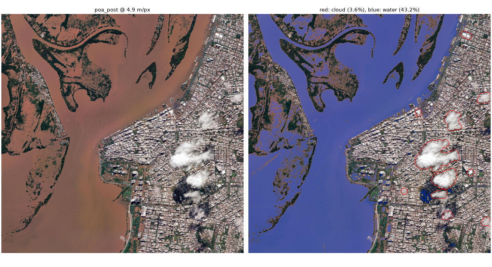
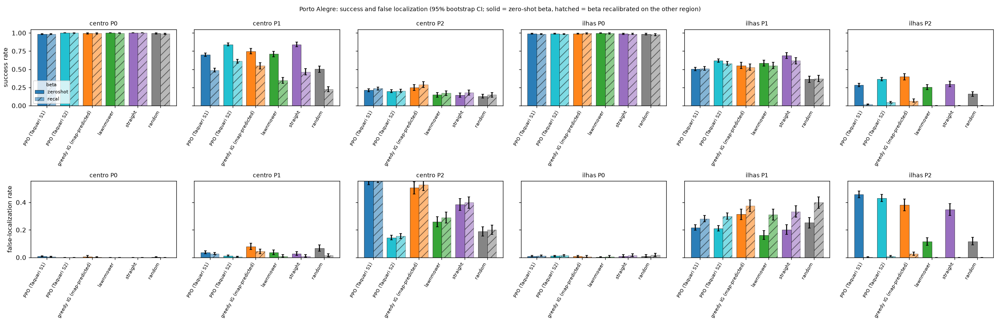
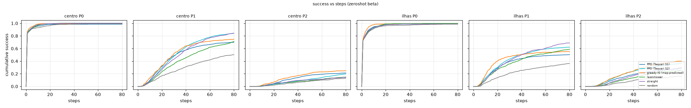
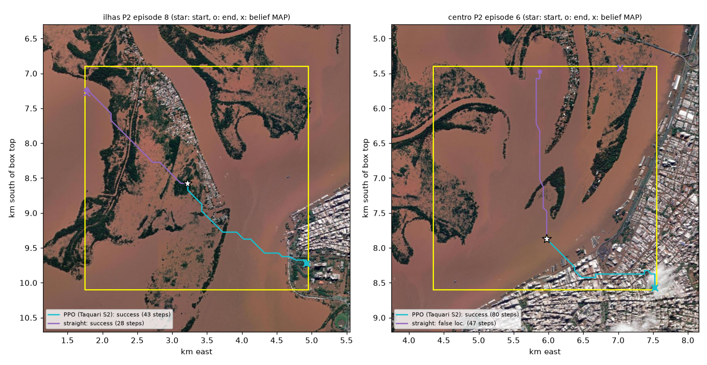
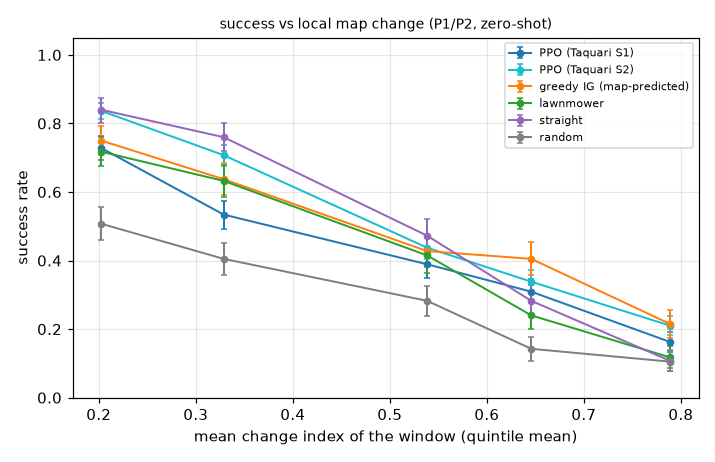
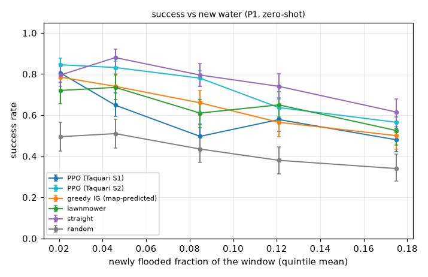

# REPORT_POA: zero-shot transfer of the Taquari localization policies to Porto Alegre (May 2024 flood)

*Generated automatically by `python -m dal.poa_report`. Every number below is read from files in `results_poa/`.*

## 1. Data

POA box grid: 192 × 242 cells of 50 m. Data gate **PASSED** (hand-measured facts ±30 %, alignment ≤ 10.0 m).

| check | expected | measured | rel_diff | ok |
|---|---|---|---|---|
| valid_km2 poa_post | 117.500 | 116.150 | -0.011 | True |
| valid_km2 poa_pre_feb24 | 117.500 | 116.130 | -0.012 | True |
| valid_km2 poa_pre_dec22 | 89.100 | 87.380 | -0.019 | True |
| overlap_km2 poa_pre_feb24 | 116.500 | 116.110 | -0.003 | True |
| overlap_km2 poa_pre_dec22 | 88.200 | 87.360 | -0.010 | True |
| align poa_pre_feb24 (m) | <= 10.0 | 2.830 |  | True |
| align poa_pre_dec22 (m) | <= 10.0 | 0.680 |  | True |

| date | valid_km2 | cloud_frac_of_valid | cloud_poc_detector_frac | water_frac_of_valid | cells_ok_frac | dx_m | dy_m | norm_m | applied |
|---|---|---|---|---|---|---|---|---|---|
| poa_post | 116.151 | 0.080 | 0.078 | 0.393 | 0.884 | 0.000 | 0.000 | 0.000 | False |
| poa_pre_feb24 | 116.133 | 0.003 | 0.012 | 0.233 | 0.991 | -0.436 | 2.800 | 2.834 | True |
| poa_pre_dec22 | 87.380 | 0.002 | 0.002 | 0.039 | 0.743 | 0.400 | -0.550 | 0.680 | False |

Regions: `ilhas` 79.2 km² (rows [0, 220], cols [0, 144]), `centro` 40.2 km² (rows [89, 242], cols [87, 192]); overlap 18.7 km² (7467 cells).

Valid 64×64 windows (≥ 70 % usable cells) per region × scenario: ilhas_P0: 10334, ilhas_P1: 10334, ilhas_P2: 10334, centro_P0: 3780, centro_P1: 3780, centro_P2: 829. Evaluated (≥ 20 windows): ilhas_P0, ilhas_P1, ilhas_P2, centro_P0, centro_P1, centro_P2.

## 2. Sanity gate

P0 (map = observation date), 200 episodes per cell; straight must reach ≥ 0.90: **PASSED**.

| region | lawnmower | random | straight |
|---|---|---|---|
| centro | 1.000 | 0.995 | 1.000 |
| ilhas | 1.000 | 0.985 | 0.990 |

## 3. Descriptor retrieval and beta

Top-k retrieval of the true cell inside 64×64 windows (diagnostic, nothing tuned on it).

| region | scenario | top1 | top5 | top1_within1 | loglik_uniform | n_windows |
|---|---|---|---|---|---|---|
| ilhas | P0 | 0.811 | 0.876 | 0.830 | -8.269 | 30 |
| ilhas | P1 | 0.149 | 0.230 | 0.165 | -8.317 | 30 |
| ilhas | P2 | 0.091 | 0.155 | 0.104 | -8.316 | 30 |
| centro | P0 | 0.917 | 0.948 | 0.928 | -8.166 | 30 |
| centro | P1 | 0.541 | 0.649 | 0.557 | -8.304 | 30 |
| centro | P2 | 0.164 | 0.258 | 0.190 | -8.115 | 30 |

β used by the filter: `zeroshot` = Taquari β (with κ) of the mapped Taquari scenario; `recal` = β₁ and κ re-estimated on the *other* POA region (light adaptation, no PPO retraining).

| region | scenario | variant | source | beta1 | kappa | beta |
|---|---|---|---|---|---|---|
| ilhas | P0 | zeroshot | Taquari S0 | 167.131 | 1.000 | 167.131 |
| ilhas | P0 | recal | POA centro | 300.000 | 1.000 | 300.000 |
| ilhas | P1 | zeroshot | Taquari S1 | 21.569 | 0.250 | 5.392 |
| ilhas | P1 | recal | POA centro | 44.814 | 0.180 | 8.067 |
| ilhas | P2 | zeroshot | Taquari S2 | 13.909 | 0.250 | 3.477 |
| ilhas | P2 | recal | POA centro | 3.729 | 0.125 | 0.466 |
| centro | P0 | zeroshot | Taquari S0 | 167.131 | 1.000 | 167.131 |
| centro | P0 | recal | POA ilhas | 300.000 | 0.250 | 75.000 |
| centro | P1 | zeroshot | Taquari S1 | 21.569 | 0.250 | 5.392 |
| centro | P1 | recal | POA ilhas | 8.969 | 0.350 | 3.139 |
| centro | P2 | zeroshot | Taquari S2 | 13.909 | 0.250 | 3.477 |
| centro | P2 | recal | POA ilhas | 3.729 | 1.000 | 3.729 |

## 4. Main results

Paired episodes: every method sees the same windows, starts and dynamics noise. PPO rows pool the 3 training seeds (`model_seeds`); `success_seed_std` = std of the success rate across seeds. Steps over successful episodes only.

| region | scenario | variant | method | episodes | model_seeds | success | success_seed_std | false_loc | steps (median [IQR]) | distance_mean_m | decision_ms |
|---|---|---|---|---|---|---|---|---|---|---|---|
| centro | P0 | recal | ppo_S1 | 1500 | 3 | 0.983 [0.976, 0.989] | 0.002 | 0.005 [0.002, 0.009] | 1 [1–1] | 146.216 | 2.531 |
| centro | P0 | recal | ppo_S2 | 1500 | 3 | 0.999 [0.998, 1.000] | 0.001 | 0.000 [0.000, 0.000] | 1 [1–1] | 130.887 | 2.510 |
| centro | P0 | recal | greedy_map | 500 | 0 | 0.994 [0.986, 1.000] |  | 0.002 [0.000, 0.006] | 1 [1–1] | 111.143 | 102.438 |
| centro | P0 | recal | lawnmower | 500 | 0 | 0.998 [0.994, 1.000] |  | 0.000 [0.000, 0.000] | 1 [1–1] | 160.337 | 0.010 |
| centro | P0 | recal | straight | 500 | 0 | 1.000 [1.000, 1.000] |  | 0.000 [0.000, 0.000] | 1 [1–1] | 145.785 | 0.003 |
| centro | P0 | recal | random | 500 | 0 | 0.988 [0.978, 0.996] |  | 0.000 [0.000, 0.000] | 1 [1–1] | 281.478 | 0.021 |
| centro | P0 | zeroshot | ppo_S1 | 1500 | 3 | 0.986 [0.980, 0.991] | 0.000 | 0.008 [0.004, 0.013] | 1 [1–1] | 115.809 | 2.321 |
| centro | P0 | zeroshot | ppo_S2 | 1500 | 3 | 1.000 [1.000, 1.000] | 0.000 | 0.000 [0.000, 0.000] | 1 [1–1] | 105.133 | 2.674 |
| centro | P0 | zeroshot | greedy_map | 500 | 0 | 0.994 [0.986, 1.000] |  | 0.006 [0.000, 0.014] | 1 [1–1] | 96.401 | 97.774 |
| centro | P0 | zeroshot | lawnmower | 500 | 0 | 1.000 [1.000, 1.000] |  | 0.000 [0.000, 0.000] | 1 [1–1] | 104.079 | 0.005 |
| centro | P0 | zeroshot | straight | 500 | 0 | 1.000 [1.000, 1.000] |  | 0.000 [0.000, 0.000] | 1 [1–1] | 113.519 | 0.003 |
| centro | P0 | zeroshot | random | 500 | 0 | 0.994 [0.986, 1.000] |  | 0.002 [0.000, 0.006] | 1 [1–1] | 183.867 | 0.020 |
| centro | P1 | recal | ppo_S1 | 1500 | 3 | 0.487 [0.461, 0.514] | 0.084 | 0.027 [0.019, 0.036] | 33 [22–49] | 1720.030 | 2.310 |
| centro | P1 | recal | ppo_S2 | 1500 | 3 | 0.612 [0.587, 0.637] | 0.049 | 0.004 [0.001, 0.007] | 46 [33–61] | 1819.367 | 2.306 |
| centro | P1 | recal | greedy_map | 500 | 0 | 0.548 [0.502, 0.590] |  | 0.044 [0.026, 0.062] | 34 [21–48] | 1261.045 | 101.998 |
| centro | P1 | recal | lawnmower | 500 | 0 | 0.346 [0.304, 0.388] |  | 0.010 [0.002, 0.020] | 41 [23–55] | 3410.244 | 0.006 |
| centro | P1 | recal | straight | 500 | 0 | 0.464 [0.420, 0.510] |  | 0.010 [0.002, 0.020] | 40 [27–56] | 3688.375 | 0.004 |
| centro | P1 | recal | random | 500 | 0 | 0.224 [0.190, 0.260] |  | 0.014 [0.004, 0.026] | 45 [24–60] | 4318.477 | 0.025 |
| centro | P1 | zeroshot | ppo_S1 | 1500 | 3 | 0.700 [0.677, 0.723] | 0.061 | 0.037 [0.028, 0.047] | 22 [14–34] | 1343.172 | 2.284 |
| centro | P1 | zeroshot | ppo_S2 | 1500 | 3 | 0.842 [0.823, 0.860] | 0.037 | 0.013 [0.007, 0.019] | 27 [17–41] | 1387.316 | 2.364 |
| centro | P1 | zeroshot | greedy_map | 500 | 0 | 0.748 [0.710, 0.786] |  | 0.080 [0.058, 0.102] | 23 [14–34] | 1142.518 | 102.518 |
| centro | P1 | zeroshot | lawnmower | 500 | 0 | 0.710 [0.670, 0.748] |  | 0.036 [0.020, 0.054] | 31 [17–49] | 2380.039 | 0.005 |
| centro | P1 | zeroshot | straight | 500 | 0 | 0.842 [0.810, 0.874] |  | 0.026 [0.014, 0.042] | 29 [17–44] | 2293.371 | 0.004 |
| centro | P1 | zeroshot | random | 500 | 0 | 0.502 [0.458, 0.546] |  | 0.068 [0.046, 0.090] | 33 [17–51] | 3315.078 | 0.027 |
| centro | P2 | recal | ppo_S1 | 1500 | 3 | 0.236 [0.215, 0.257] | 0.081 | 0.568 [0.544, 0.593] | 30 [20–41] | 1432.346 | 2.275 |
| centro | P2 | recal | ppo_S2 | 1500 | 3 | 0.204 [0.183, 0.226] | 0.076 | 0.155 [0.138, 0.174] | 43 [25–61] | 2039.807 | 2.152 |
| centro | P2 | recal | greedy_map | 500 | 0 | 0.288 [0.250, 0.328] |  | 0.528 [0.486, 0.570] | 26 [17–42] | 1495.488 | 107.695 |
| centro | P2 | recal | lawnmower | 500 | 0 | 0.172 [0.140, 0.204] |  | 0.290 [0.250, 0.330] | 38 [17–59] | 3097.536 | 0.005 |
| centro | P2 | recal | straight | 500 | 0 | 0.178 [0.146, 0.212] |  | 0.400 [0.358, 0.440] | 32 [20–59] | 3257.524 | 0.004 |
| centro | P2 | recal | random | 500 | 0 | 0.150 [0.118, 0.182] |  | 0.200 [0.166, 0.236] | 42 [23–59] | 3983.445 | 0.021 |
| centro | P2 | zeroshot | ppo_S1 | 1500 | 3 | 0.213 [0.193, 0.233] | 0.074 | 0.555 [0.529, 0.579] | 31 [22–44] | 1472.952 | 2.222 |
| centro | P2 | zeroshot | ppo_S2 | 1500 | 3 | 0.199 [0.179, 0.219] | 0.063 | 0.144 [0.127, 0.163] | 45 [27–62] | 2065.938 | 2.212 |
| centro | P2 | zeroshot | greedy_map | 500 | 0 | 0.248 [0.210, 0.288] |  | 0.506 [0.462, 0.550] | 28 [20–45] | 1589.890 | 104.158 |
| centro | P2 | zeroshot | lawnmower | 500 | 0 | 0.148 [0.118, 0.178] |  | 0.260 [0.222, 0.296] | 38 [19–61] | 3255.812 | 0.005 |
| centro | P2 | zeroshot | straight | 500 | 0 | 0.142 [0.114, 0.174] |  | 0.384 [0.342, 0.428] | 32 [18–52] | 3391.878 | 0.004 |
| centro | P2 | zeroshot | random | 500 | 0 | 0.130 [0.102, 0.158] |  | 0.188 [0.156, 0.222] | 41 [24–59] | 4095.279 | 0.021 |
| ilhas | P0 | recal | ppo_S1 | 1500 | 3 | 0.985 [0.978, 0.991] | 0.004 | 0.013 [0.007, 0.019] | 1 [1–1] | 129.478 | 2.855 |
| ilhas | P0 | recal | ppo_S2 | 1500 | 3 | 0.983 [0.976, 0.989] | 0.008 | 0.015 [0.009, 0.022] | 1 [1–1] | 121.563 | 2.912 |
| ilhas | P0 | recal | greedy_map | 500 | 0 | 0.994 [0.986, 1.000] |  | 0.006 [0.000, 0.014] | 1 [1–1] | 108.813 | 101.961 |
| ilhas | P0 | recal | lawnmower | 500 | 0 | 0.994 [0.986, 1.000] |  | 0.006 [0.000, 0.014] | 1 [1–1] | 114.657 | 0.008 |
| ilhas | P0 | recal | straight | 500 | 0 | 0.986 [0.976, 0.996] |  | 0.014 [0.004, 0.026] | 1 [1–1] | 126.985 | 0.003 |
| ilhas | P0 | recal | random | 500 | 0 | 0.978 [0.964, 0.990] |  | 0.018 [0.006, 0.030] | 1 [1–1] | 186.113 | 0.021 |
| ilhas | P0 | zeroshot | ppo_S1 | 1500 | 3 | 0.989 [0.983, 0.993] | 0.001 | 0.010 [0.005, 0.015] | 1 [1–2] | 156.315 | 2.853 |
| ilhas | P0 | zeroshot | ppo_S2 | 1500 | 3 | 0.988 [0.982, 0.993] | 0.007 | 0.011 [0.006, 0.016] | 1 [1–2] | 150.993 | 2.664 |
| ilhas | P0 | zeroshot | greedy_map | 500 | 0 | 0.992 [0.984, 0.998] |  | 0.008 [0.002, 0.016] | 1 [1–1] | 122.528 | 77.147 |
| ilhas | P0 | zeroshot | lawnmower | 500 | 0 | 0.998 [0.994, 1.000] |  | 0.002 [0.000, 0.006] | 1 [1–2] | 149.442 | 0.005 |
| ilhas | P0 | zeroshot | straight | 500 | 0 | 0.990 [0.980, 0.998] |  | 0.010 [0.002, 0.020] | 1 [1–2] | 163.227 | 0.004 |
| ilhas | P0 | zeroshot | random | 500 | 0 | 0.986 [0.974, 0.996] |  | 0.010 [0.002, 0.020] | 1 [1–2] | 235.935 | 0.021 |
| ilhas | P1 | recal | ppo_S1 | 1500 | 3 | 0.511 [0.485, 0.536] | 0.006 | 0.281 [0.258, 0.304] | 12 [7–22] | 1005.384 | 2.121 |
| ilhas | P1 | recal | ppo_S2 | 1500 | 3 | 0.580 [0.554, 0.607] | 0.055 | 0.299 [0.277, 0.322] | 14 [7–25] | 1010.604 | 2.132 |
| ilhas | P1 | recal | greedy_map | 500 | 0 | 0.528 [0.484, 0.572] |  | 0.376 [0.332, 0.418] | 9 [5–14] | 939.519 | 91.025 |
| ilhas | P1 | recal | lawnmower | 500 | 0 | 0.552 [0.508, 0.594] |  | 0.310 [0.270, 0.352] | 16 [9–30] | 1600.313 | 0.004 |
| ilhas | P1 | recal | straight | 500 | 0 | 0.620 [0.576, 0.662] |  | 0.334 [0.294, 0.374] | 16 [9–29] | 1525.123 | 0.003 |
| ilhas | P1 | recal | random | 500 | 0 | 0.372 [0.330, 0.416] |  | 0.400 [0.356, 0.440] | 16 [9–32] | 2293.255 | 0.019 |
| ilhas | P1 | zeroshot | ppo_S1 | 1500 | 3 | 0.503 [0.479, 0.528] | 0.035 | 0.217 [0.197, 0.239] | 18 [10–28] | 1225.772 | 2.139 |
| ilhas | P1 | zeroshot | ppo_S2 | 1500 | 3 | 0.621 [0.596, 0.645] | 0.068 | 0.211 [0.191, 0.232] | 21 [12–34] | 1245.946 | 2.206 |
| ilhas | P1 | zeroshot | greedy_map | 500 | 0 | 0.552 [0.510, 0.598] |  | 0.314 [0.274, 0.352] | 14 [9–21] | 1277.212 | 94.864 |
| ilhas | P1 | zeroshot | lawnmower | 500 | 0 | 0.586 [0.542, 0.626] |  | 0.162 [0.130, 0.196] | 23 [13–42] | 2220.810 | 0.004 |
| ilhas | P1 | zeroshot | straight | 500 | 0 | 0.688 [0.648, 0.728] |  | 0.202 [0.168, 0.238] | 24 [14–42] | 2117.832 | 0.004 |
| ilhas | P1 | zeroshot | random | 500 | 0 | 0.362 [0.320, 0.404] |  | 0.252 [0.214, 0.290] | 27 [15–47] | 3085.227 | 0.023 |
| ilhas | P2 | recal | ppo_S1 | 1500 | 3 | 0.015 [0.009, 0.021] | 0.015 | 0.003 [0.001, 0.007] | 65 [58–76] | 1943.225 | 2.117 |
| ilhas | P2 | recal | ppo_S2 | 1500 | 3 | 0.048 [0.037, 0.059] | 0.026 | 0.009 [0.005, 0.015] | 68 [59–75] | 1989.843 | 2.171 |
| ilhas | P2 | recal | greedy_map | 500 | 0 | 0.066 [0.044, 0.090] |  | 0.026 [0.014, 0.040] | 60 [51–72] | 1791.707 | 93.633 |
| ilhas | P2 | recal | lawnmower | 500 | 0 | 0.000 [0.000, 0.000] |  | 0.000 [0.000, 0.000] | – | 4136.457 | 0.005 |
| ilhas | P2 | recal | straight | 500 | 0 | 0.000 [0.000, 0.000] |  | 0.000 [0.000, 0.000] | – | 4793.751 | 0.003 |
| ilhas | P2 | recal | random | 500 | 0 | 0.000 [0.000, 0.000] |  | 0.000 [0.000, 0.000] | – | 4844.457 | 0.019 |
| ilhas | P2 | zeroshot | ppo_S1 | 1500 | 3 | 0.283 [0.259, 0.305] | 0.042 | 0.458 [0.432, 0.482] | 32 [19–45] | 1645.160 | 2.167 |
| ilhas | P2 | zeroshot | ppo_S2 | 1500 | 3 | 0.362 [0.339, 0.387] | 0.030 | 0.431 [0.407, 0.457] | 30 [19–47] | 1548.823 | 2.134 |
| ilhas | P2 | zeroshot | greedy_map | 500 | 0 | 0.400 [0.354, 0.442] |  | 0.380 [0.340, 0.424] | 33 [19–49] | 1996.942 | 91.809 |
| ilhas | P2 | zeroshot | lawnmower | 500 | 0 | 0.254 [0.218, 0.292] |  | 0.116 [0.088, 0.142] | 38 [24–52] | 3350.270 | 0.005 |
| ilhas | P2 | zeroshot | straight | 500 | 0 | 0.298 [0.258, 0.338] |  | 0.348 [0.306, 0.392] | 36 [23–51] | 3186.511 | 0.004 |
| ilhas | P2 | zeroshot | random | 500 | 0 | 0.160 [0.128, 0.192] |  | 0.116 [0.090, 0.146] | 37 [23–52] | 4223.254 | 0.019 |

### Paired tests (PPO vs each method)

`success_diff`, `distance_diff_m` = PPO − other (paired bootstrap 95 % CI); Wilcoxon signed-rank on per-episode penalized steps (failure = 81).

| region | scenario | variant | ref | vs | n | success_diff | success_diff_lo | success_diff_hi | distance_diff_m | distance_diff_lo | distance_diff_hi | wilcoxon_p |
|---|---|---|---|---|---|---|---|---|---|---|---|---|
| centro | P0 | recal | ppo_S1 | ppo_S2 | 500 | -0.017 | -0.027 | -0.007 | 15.329 | -0.895 | 31.279 | 0.000 |
| centro | P0 | recal | ppo_S1 | greedy_map | 500 | -0.011 | -0.020 | -0.005 | 35.073 | 21.390 | 49.344 | 0.000 |
| centro | P0 | recal | ppo_S1 | lawnmower | 500 | -0.015 | -0.025 | -0.007 | -14.121 | -43.375 | 11.436 | 0.060 |
| centro | P0 | recal | ppo_S1 | straight | 500 | -0.017 | -0.028 | -0.009 | 0.431 | -17.985 | 17.748 | 0.001 |
| centro | P0 | recal | ppo_S1 | random | 500 | -0.005 | -0.016 | 0.005 | -135.262 | -193.224 | -81.642 | 0.782 |
| centro | P0 | recal | ppo_S2 | ppo_S1 | 500 | 0.017 | 0.007 | 0.027 | -15.329 | -31.213 | -0.108 | 0.000 |
| centro | P0 | recal | ppo_S2 | greedy_map | 500 | 0.005 | -0.001 | 0.013 | 19.744 | 9.753 | 30.940 | 0.000 |
| centro | P0 | recal | ppo_S2 | lawnmower | 500 | 0.001 | -0.002 | 0.006 | -29.450 | -55.658 | -4.714 | 0.187 |
| centro | P0 | recal | ppo_S2 | straight | 500 | -0.001 | -0.002 | 0.000 | -14.898 | -35.602 | 2.776 | 0.783 |
| centro | P0 | recal | ppo_S2 | random | 500 | 0.011 | 0.003 | 0.021 | -150.591 | -209.280 | -98.480 | 0.003 |
| centro | P0 | zeroshot | ppo_S1 | ppo_S2 | 500 | -0.014 | -0.023 | -0.006 | 10.675 | -0.467 | 22.456 | 0.011 |
| centro | P0 | zeroshot | ppo_S1 | greedy_map | 500 | -0.008 | -0.014 | -0.003 | 19.407 | 11.003 | 29.149 | 0.000 |
| centro | P0 | zeroshot | ppo_S1 | lawnmower | 500 | -0.014 | -0.023 | -0.006 | 11.729 | 0.411 | 22.659 | 0.171 |
| centro | P0 | zeroshot | ppo_S1 | straight | 500 | -0.014 | -0.023 | -0.006 | 2.290 | -10.798 | 13.885 | 0.013 |
| centro | P0 | zeroshot | ppo_S1 | random | 500 | -0.008 | -0.019 | 0.003 | -68.058 | -108.617 | -35.208 | 0.898 |
| centro | P0 | zeroshot | ppo_S2 | ppo_S1 | 500 | 0.014 | 0.006 | 0.024 | -10.675 | -22.231 | -0.148 | 0.011 |
| centro | P0 | zeroshot | ppo_S2 | greedy_map | 500 | 0.006 | 0.000 | 0.014 | 8.732 | 1.683 | 16.590 | 0.004 |
| centro | P0 | zeroshot | ppo_S2 | lawnmower | 500 | 0.000 | 0.000 | 0.000 | 1.054 | -7.859 | 9.806 | 0.134 |
| centro | P0 | zeroshot | ppo_S2 | straight | 500 | 0.000 | 0.000 | 0.000 | -8.385 | -22.070 | 2.190 | 0.665 |
| centro | P0 | zeroshot | ppo_S2 | random | 500 | 0.006 | 0.000 | 0.014 | -78.734 | -116.593 | -46.905 | 0.006 |
| centro | P1 | recal | ppo_S1 | ppo_S2 | 500 | -0.125 | -0.168 | -0.083 | -99.337 | -204.361 | 14.138 | 0.540 |
| centro | P1 | recal | ppo_S1 | greedy_map | 500 | -0.061 | -0.115 | -0.007 | 458.985 | 342.551 | 580.328 | 0.250 |
| centro | P1 | recal | ppo_S1 | lawnmower | 500 | 0.141 | 0.089 | 0.192 | -1690.214 | -1806.187 | -1563.736 | 0.000 |
| centro | P1 | recal | ppo_S1 | straight | 500 | 0.023 | -0.031 | 0.078 | -1968.346 | -2120.514 | -1815.636 | 0.001 |
| centro | P1 | recal | ppo_S1 | random | 500 | 0.263 | 0.215 | 0.313 | -2598.447 | -2716.844 | -2470.169 | 0.000 |
| centro | P1 | recal | ppo_S2 | ppo_S1 | 500 | 0.125 | 0.084 | 0.165 | 99.337 | -9.495 | 209.143 | 0.540 |
| centro | P1 | recal | ppo_S2 | greedy_map | 500 | 0.064 | 0.017 | 0.111 | 558.322 | 463.178 | 650.405 | 0.015 |
| centro | P1 | recal | ppo_S2 | lawnmower | 500 | 0.266 | 0.218 | 0.314 | -1590.877 | -1724.440 | -1465.459 | 0.000 |
| centro | P1 | recal | ppo_S2 | straight | 500 | 0.148 | 0.097 | 0.195 | -1869.009 | -2014.717 | -1708.484 | 0.001 |
| centro | P1 | recal | ppo_S2 | random | 500 | 0.388 | 0.346 | 0.431 | -2499.110 | -2620.811 | -2370.361 | 0.000 |
| centro | P1 | zeroshot | ppo_S1 | ppo_S2 | 500 | -0.142 | -0.183 | -0.103 | -44.144 | -138.696 | 47.408 | 0.019 |
| centro | P1 | zeroshot | ppo_S1 | greedy_map | 500 | -0.048 | -0.098 | 0.001 | 200.654 | 88.766 | 309.955 | 0.129 |
| centro | P1 | zeroshot | ppo_S1 | lawnmower | 500 | -0.010 | -0.059 | 0.037 | -1036.868 | -1166.108 | -914.158 | 0.000 |
| centro | P1 | zeroshot | ppo_S1 | straight | 500 | -0.142 | -0.191 | -0.093 | -950.200 | -1085.653 | -813.088 | 0.083 |
| centro | P1 | zeroshot | ppo_S1 | random | 500 | 0.198 | 0.143 | 0.251 | -1971.907 | -2122.890 | -1818.894 | 0.000 |
| centro | P1 | zeroshot | ppo_S2 | ppo_S1 | 500 | 0.142 | 0.103 | 0.180 | 44.144 | -43.671 | 140.918 | 0.019 |
| centro | P1 | zeroshot | ppo_S2 | greedy_map | 500 | 0.094 | 0.055 | 0.133 | 244.798 | 157.494 | 331.774 | 0.511 |
| centro | P1 | zeroshot | ppo_S2 | lawnmower | 500 | 0.132 | 0.091 | 0.175 | -992.724 | -1132.230 | -860.340 | 0.000 |
| centro | P1 | zeroshot | ppo_S2 | straight | 500 | -0.000 | -0.037 | 0.037 | -906.056 | -1036.215 | -768.295 | 0.588 |
| centro | P1 | zeroshot | ppo_S2 | random | 500 | 0.340 | 0.294 | 0.388 | -1927.763 | -2079.038 | -1783.170 | 0.000 |
| centro | P2 | recal | ppo_S1 | ppo_S2 | 500 | 0.032 | -0.001 | 0.065 | -607.460 | -691.761 | -525.388 | 0.048 |
| centro | P2 | recal | ppo_S1 | greedy_map | 500 | -0.052 | -0.093 | -0.010 | -63.142 | -171.636 | 37.318 | 0.893 |
| centro | P2 | recal | ppo_S1 | lawnmower | 500 | 0.064 | 0.021 | 0.105 | -1665.190 | -1795.119 | -1523.351 | 0.000 |
| centro | P2 | recal | ppo_S1 | straight | 500 | 0.058 | 0.015 | 0.101 | -1825.178 | -1988.102 | -1653.995 | 0.000 |
| centro | P2 | recal | ppo_S1 | random | 500 | 0.086 | 0.045 | 0.127 | -2551.099 | -2682.988 | -2411.181 | 0.000 |
| centro | P2 | recal | ppo_S2 | ppo_S1 | 500 | -0.032 | -0.067 | 0.003 | 607.460 | 525.026 | 690.396 | 0.048 |
| centro | P2 | recal | ppo_S2 | greedy_map | 500 | -0.084 | -0.127 | -0.039 | 544.319 | 405.890 | 669.369 | 0.340 |
| centro | P2 | recal | ppo_S2 | lawnmower | 500 | 0.032 | -0.005 | 0.069 | -1057.730 | -1194.790 | -917.629 | 0.000 |
| centro | P2 | recal | ppo_S2 | straight | 500 | 0.026 | -0.013 | 0.064 | -1217.718 | -1377.314 | -1067.030 | 0.000 |
| centro | P2 | recal | ppo_S2 | random | 500 | 0.054 | 0.019 | 0.089 | -1943.638 | -2091.641 | -1799.121 | 0.000 |
| centro | P2 | zeroshot | ppo_S1 | ppo_S2 | 500 | 0.014 | -0.020 | 0.048 | -592.986 | -678.477 | -508.684 | 0.334 |
| centro | P2 | zeroshot | ppo_S1 | greedy_map | 500 | -0.035 | -0.077 | 0.010 | -116.938 | -221.617 | -12.416 | 0.849 |
| centro | P2 | zeroshot | ppo_S1 | lawnmower | 500 | 0.065 | 0.027 | 0.103 | -1782.860 | -1910.088 | -1657.000 | 0.000 |
| centro | P2 | zeroshot | ppo_S1 | straight | 500 | 0.071 | 0.029 | 0.109 | -1918.925 | -2074.117 | -1753.271 | 0.000 |
| centro | P2 | zeroshot | ppo_S1 | random | 500 | 0.083 | 0.041 | 0.122 | -2622.327 | -2753.843 | -2485.820 | 0.000 |
| centro | P2 | zeroshot | ppo_S2 | ppo_S1 | 500 | -0.014 | -0.045 | 0.020 | 592.986 | 513.594 | 680.102 | 0.334 |
| centro | P2 | zeroshot | ppo_S2 | greedy_map | 500 | -0.049 | -0.092 | -0.008 | 476.048 | 344.471 | 606.642 | 0.922 |
| centro | P2 | zeroshot | ppo_S2 | lawnmower | 500 | 0.051 | 0.015 | 0.085 | -1189.874 | -1323.638 | -1054.651 | 0.000 |
| centro | P2 | zeroshot | ppo_S2 | straight | 500 | 0.057 | 0.019 | 0.093 | -1325.939 | -1487.367 | -1159.176 | 0.000 |
| centro | P2 | zeroshot | ppo_S2 | random | 500 | 0.069 | 0.035 | 0.101 | -2029.341 | -2177.007 | -1880.796 | 0.000 |
| ilhas | P0 | recal | ppo_S1 | ppo_S2 | 500 | 0.002 | -0.007 | 0.011 | 7.915 | -2.954 | 19.954 | 0.048 |
| ilhas | P0 | recal | ppo_S1 | greedy_map | 500 | -0.009 | -0.019 | -0.000 | 20.664 | 9.438 | 32.048 | 0.000 |
| ilhas | P0 | recal | ppo_S1 | lawnmower | 500 | -0.009 | -0.019 | -0.000 | 14.821 | 5.694 | 25.111 | 0.745 |
| ilhas | P0 | recal | ppo_S1 | straight | 500 | -0.001 | -0.013 | 0.011 | 2.493 | -10.148 | 15.667 | 0.634 |
| ilhas | P0 | recal | ppo_S1 | random | 500 | 0.007 | -0.005 | 0.019 | -56.635 | -95.034 | -25.945 | 0.213 |
| ilhas | P0 | recal | ppo_S2 | ppo_S1 | 500 | -0.002 | -0.011 | 0.007 | -7.915 | -19.477 | 3.182 | 0.048 |
| ilhas | P0 | recal | ppo_S2 | greedy_map | 500 | -0.011 | -0.020 | -0.002 | 12.749 | 2.611 | 23.445 | 0.000 |
| ilhas | P0 | recal | ppo_S2 | lawnmower | 500 | -0.011 | -0.020 | -0.003 | 6.906 | -4.089 | 18.223 | 0.017 |
| ilhas | P0 | recal | ppo_S2 | straight | 500 | -0.003 | -0.011 | 0.006 | -5.422 | -15.815 | 4.980 | 0.016 |
| ilhas | P0 | recal | ppo_S2 | random | 500 | 0.005 | -0.007 | 0.018 | -64.550 | -101.587 | -30.710 | 0.676 |
| ilhas | P0 | zeroshot | ppo_S1 | ppo_S2 | 500 | 0.001 | -0.007 | 0.009 | 5.322 | -9.669 | 21.167 | 0.176 |
| ilhas | P0 | zeroshot | ppo_S1 | greedy_map | 500 | -0.003 | -0.013 | 0.007 | 33.787 | 18.393 | 49.236 | 0.000 |
| ilhas | P0 | zeroshot | ppo_S1 | lawnmower | 500 | -0.009 | -0.017 | -0.003 | 6.873 | -10.472 | 22.585 | 0.893 |
| ilhas | P0 | zeroshot | ppo_S1 | straight | 500 | -0.001 | -0.011 | 0.009 | -6.912 | -27.592 | 13.338 | 0.635 |
| ilhas | P0 | zeroshot | ppo_S1 | random | 500 | 0.003 | -0.007 | 0.013 | -79.620 | -121.044 | -41.332 | 0.112 |
| ilhas | P0 | zeroshot | ppo_S2 | ppo_S1 | 500 | -0.001 | -0.009 | 0.008 | -5.322 | -20.094 | 9.343 | 0.176 |
| ilhas | P0 | zeroshot | ppo_S2 | greedy_map | 500 | -0.004 | -0.013 | 0.006 | 28.465 | 14.557 | 42.023 | 0.000 |
| ilhas | P0 | zeroshot | ppo_S2 | lawnmower | 500 | -0.010 | -0.016 | -0.005 | 1.551 | -17.296 | 19.452 | 0.376 |
| ilhas | P0 | zeroshot | ppo_S2 | straight | 500 | -0.002 | -0.009 | 0.005 | -12.234 | -31.206 | 6.394 | 0.232 |
| ilhas | P0 | zeroshot | ppo_S2 | random | 500 | 0.002 | -0.007 | 0.012 | -84.942 | -130.497 | -47.044 | 0.721 |
| ilhas | P1 | recal | ppo_S1 | ppo_S2 | 500 | -0.069 | -0.109 | -0.027 | -5.220 | -72.159 | 60.728 | 0.028 |
| ilhas | P1 | recal | ppo_S1 | greedy_map | 500 | -0.017 | -0.065 | 0.031 | 65.865 | -26.754 | 159.057 | 0.003 |
| ilhas | P1 | recal | ppo_S1 | lawnmower | 500 | -0.041 | -0.089 | 0.009 | -594.929 | -710.054 | -485.208 | 0.746 |
| ilhas | P1 | recal | ppo_S1 | straight | 500 | -0.109 | -0.158 | -0.058 | -519.739 | -630.547 | -407.315 | 0.011 |
| ilhas | P1 | recal | ppo_S1 | random | 500 | 0.139 | 0.094 | 0.185 | -1287.871 | -1425.480 | -1137.705 | 0.000 |
| ilhas | P1 | recal | ppo_S2 | ppo_S1 | 500 | 0.069 | 0.025 | 0.115 | 5.220 | -58.930 | 71.868 | 0.028 |
| ilhas | P1 | recal | ppo_S2 | greedy_map | 500 | 0.052 | 0.012 | 0.093 | 71.085 | -16.116 | 153.311 | 0.576 |
| ilhas | P1 | recal | ppo_S2 | lawnmower | 500 | 0.028 | -0.018 | 0.070 | -589.709 | -705.982 | -477.546 | 0.007 |
| ilhas | P1 | recal | ppo_S2 | straight | 500 | -0.040 | -0.085 | 0.005 | -514.519 | -616.335 | -413.666 | 0.745 |
| ilhas | P1 | recal | ppo_S2 | random | 500 | 0.208 | 0.164 | 0.252 | -1282.650 | -1425.776 | -1138.751 | 0.000 |
| ilhas | P1 | zeroshot | ppo_S1 | ppo_S2 | 500 | -0.118 | -0.160 | -0.075 | -20.173 | -97.536 | 59.360 | 0.001 |
| ilhas | P1 | zeroshot | ppo_S1 | greedy_map | 500 | -0.049 | -0.095 | 0.001 | -51.440 | -158.171 | 48.631 | 0.004 |
| ilhas | P1 | zeroshot | ppo_S1 | lawnmower | 500 | -0.083 | -0.132 | -0.034 | -995.038 | -1124.857 | -868.276 | 0.870 |
| ilhas | P1 | zeroshot | ppo_S1 | straight | 500 | -0.185 | -0.231 | -0.136 | -892.060 | -1018.000 | -764.256 | 0.000 |
| ilhas | P1 | zeroshot | ppo_S1 | random | 500 | 0.141 | 0.089 | 0.191 | -1859.455 | -2011.589 | -1715.160 | 0.000 |
| ilhas | P1 | zeroshot | ppo_S2 | ppo_S1 | 500 | 0.118 | 0.075 | 0.163 | 20.173 | -58.141 | 101.413 | 0.001 |
| ilhas | P1 | zeroshot | ppo_S2 | greedy_map | 500 | 0.069 | 0.025 | 0.116 | -31.267 | -136.403 | 65.032 | 0.807 |
| ilhas | P1 | zeroshot | ppo_S2 | lawnmower | 500 | 0.035 | -0.011 | 0.079 | -974.864 | -1103.366 | -848.552 | 0.001 |
| ilhas | P1 | zeroshot | ppo_S2 | straight | 500 | -0.067 | -0.113 | -0.020 | -871.886 | -1001.379 | -750.058 | 0.825 |
| ilhas | P1 | zeroshot | ppo_S2 | random | 500 | 0.259 | 0.211 | 0.308 | -1839.282 | -1987.016 | -1694.642 | 0.000 |
| ilhas | P2 | recal | ppo_S1 | ppo_S2 | 500 | -0.033 | -0.047 | -0.020 | -46.618 | -153.566 | 59.694 | 0.001 |
| ilhas | P2 | recal | ppo_S1 | greedy_map | 500 | -0.051 | -0.074 | -0.029 | 151.518 | 28.197 | 285.372 | 0.171 |
| ilhas | P2 | recal | ppo_S1 | lawnmower | 500 | 0.015 | 0.008 | 0.023 | -2193.232 | -2279.310 | -2106.884 | 0.102 |
| ilhas | P2 | recal | ppo_S1 | straight | 500 | 0.015 | 0.008 | 0.022 | -2850.526 | -2955.505 | -2746.993 | 0.102 |
| ilhas | P2 | recal | ppo_S1 | random | 500 | 0.015 | 0.008 | 0.022 | -2901.231 | -2987.975 | -2820.039 | 0.102 |
| ilhas | P2 | recal | ppo_S2 | ppo_S1 | 500 | 0.033 | 0.021 | 0.047 | 46.618 | -60.389 | 152.207 | 0.001 |
| ilhas | P2 | recal | ppo_S2 | greedy_map | 500 | -0.018 | -0.042 | 0.005 | 198.136 | 59.861 | 335.168 | 0.078 |
| ilhas | P2 | recal | ppo_S2 | lawnmower | 500 | 0.048 | 0.037 | 0.059 | -2146.614 | -2222.861 | -2072.257 | 0.000 |
| ilhas | P2 | recal | ppo_S2 | straight | 500 | 0.048 | 0.037 | 0.060 | -2803.908 | -2901.780 | -2700.913 | 0.000 |
| ilhas | P2 | recal | ppo_S2 | random | 500 | 0.048 | 0.037 | 0.059 | -2854.614 | -2932.082 | -2778.085 | 0.000 |
| ilhas | P2 | zeroshot | ppo_S1 | ppo_S2 | 500 | -0.079 | -0.121 | -0.037 | 96.337 | 0.459 | 190.403 | 0.001 |
| ilhas | P2 | zeroshot | ppo_S1 | greedy_map | 500 | -0.117 | -0.169 | -0.069 | -351.782 | -486.656 | -221.428 | 0.006 |
| ilhas | P2 | zeroshot | ppo_S1 | lawnmower | 500 | 0.029 | -0.020 | 0.076 | -1705.110 | -1827.203 | -1578.560 | 0.000 |
| ilhas | P2 | zeroshot | ppo_S1 | straight | 500 | -0.015 | -0.060 | 0.033 | -1541.351 | -1683.730 | -1382.887 | 0.116 |
| ilhas | P2 | zeroshot | ppo_S1 | random | 500 | 0.123 | 0.085 | 0.163 | -2578.094 | -2697.303 | -2458.636 | 0.000 |
| ilhas | P2 | zeroshot | ppo_S2 | ppo_S1 | 500 | 0.079 | 0.036 | 0.123 | -96.337 | -189.720 | -3.604 | 0.001 |
| ilhas | P2 | zeroshot | ppo_S2 | greedy_map | 500 | -0.038 | -0.088 | 0.011 | -448.119 | -580.827 | -311.212 | 0.581 |
| ilhas | P2 | zeroshot | ppo_S2 | lawnmower | 500 | 0.108 | 0.066 | 0.150 | -1801.447 | -1919.967 | -1687.191 | 0.000 |
| ilhas | P2 | zeroshot | ppo_S2 | straight | 500 | 0.064 | 0.018 | 0.110 | -1637.688 | -1784.559 | -1506.955 | 0.000 |
| ilhas | P2 | zeroshot | ppo_S2 | random | 500 | 0.202 | 0.163 | 0.241 | -2674.431 | -2792.721 | -2555.618 | 0.000 |

## 5. Comparison with the Taquari

PPO − straight (Δsuccess with 95 % CI; Δdistance = mean distance PPO − straight). Taquari rows copied from the PoC results into `taquari_reference.csv`.

| site | scenario | ref | variant | success_diff | lo | hi | distance_diff_m |
|---|---|---|---|---|---|---|---|
| Taquari (test) | S1 | ppo | - | -0.087 | -0.110 | -0.063 | -150.755 |
| Taquari (test) | S2 | ppo | - | 0.007 | -0.027 | 0.040 | -1123.537 |
| POA centro | P1 | ppo_S1 | recal | 0.023 | -0.031 | 0.078 | -1968.346 |
| POA centro | P1 | ppo_S2 | recal | 0.148 | 0.097 | 0.195 | -1869.009 |
| POA centro | P1 | ppo_S1 | zeroshot | -0.142 | -0.191 | -0.093 | -950.200 |
| POA centro | P1 | ppo_S2 | zeroshot | -0.000 | -0.037 | 0.037 | -906.056 |
| POA ilhas | P1 | ppo_S1 | recal | -0.109 | -0.158 | -0.058 | -519.739 |
| POA ilhas | P1 | ppo_S2 | recal | -0.040 | -0.085 | 0.005 | -514.519 |
| POA ilhas | P1 | ppo_S1 | zeroshot | -0.185 | -0.231 | -0.136 | -892.060 |
| POA ilhas | P1 | ppo_S2 | zeroshot | -0.067 | -0.113 | -0.020 | -871.886 |

## 6. Change index

Change index per cell = 1 − cos(map descriptor, mean observation descriptor); per episode, its mean over the window's usable cells. Quintiles over all non-control episodes (zero-shot β, scenarios P1, P2, both regions pooled; `share_ilhas` = fraction of the bin's episodes in ilhas).

| method | bin | lo_edge | hi_edge | n | share_ilhas | success | success_lo | success_hi | false_loc |
|---|---|---|---|---|---|---|---|---|---|
| ppo_S1 | 1 | 0.176 | 0.230 | 400 | 0.028 | 0.728 | 0.693 | 0.763 | 0.024 |
| ppo_S1 | 2 | 0.230 | 0.426 | 400 | 0.723 | 0.534 | 0.493 | 0.573 | 0.138 |
| ppo_S1 | 3 | 0.426 | 0.607 | 400 | 0.693 | 0.389 | 0.350 | 0.429 | 0.407 |
| ppo_S1 | 4 | 0.607 | 0.698 | 400 | 0.785 | 0.309 | 0.275 | 0.346 | 0.456 |
| ppo_S1 | 5 | 0.698 | 0.886 | 400 | 0.273 | 0.163 | 0.134 | 0.192 | 0.559 |
| ppo_S2 | 1 | 0.176 | 0.230 | 400 | 0.028 | 0.837 | 0.812 | 0.860 | 0.010 |
| ppo_S2 | 2 | 0.230 | 0.426 | 400 | 0.723 | 0.708 | 0.677 | 0.738 | 0.113 |
| ppo_S2 | 3 | 0.426 | 0.607 | 400 | 0.693 | 0.438 | 0.404 | 0.472 | 0.254 |
| ppo_S2 | 4 | 0.607 | 0.698 | 400 | 0.785 | 0.338 | 0.304 | 0.372 | 0.360 |
| ppo_S2 | 5 | 0.698 | 0.886 | 400 | 0.273 | 0.210 | 0.184 | 0.237 | 0.260 |
| greedy_map | 1 | 0.176 | 0.230 | 400 | 0.028 | 0.750 | 0.708 | 0.792 | 0.058 |
| greedy_map | 2 | 0.230 | 0.426 | 400 | 0.723 | 0.637 | 0.590 | 0.685 | 0.230 |
| greedy_map | 3 | 0.426 | 0.607 | 400 | 0.693 | 0.427 | 0.380 | 0.475 | 0.385 |
| greedy_map | 4 | 0.607 | 0.698 | 400 | 0.785 | 0.405 | 0.357 | 0.455 | 0.370 |
| greedy_map | 5 | 0.698 | 0.886 | 400 | 0.273 | 0.215 | 0.175 | 0.255 | 0.557 |
| lawnmower | 1 | 0.176 | 0.230 | 400 | 0.028 | 0.718 | 0.675 | 0.760 | 0.018 |
| lawnmower | 2 | 0.230 | 0.426 | 400 | 0.723 | 0.632 | 0.585 | 0.680 | 0.145 |
| lawnmower | 3 | 0.426 | 0.607 | 400 | 0.693 | 0.415 | 0.365 | 0.465 | 0.135 |
| lawnmower | 4 | 0.607 | 0.698 | 400 | 0.785 | 0.240 | 0.200 | 0.282 | 0.160 |
| lawnmower | 5 | 0.698 | 0.886 | 400 | 0.273 | 0.117 | 0.087 | 0.150 | 0.260 |
| straight | 1 | 0.176 | 0.230 | 400 | 0.028 | 0.840 | 0.802 | 0.875 | 0.015 |
| straight | 2 | 0.230 | 0.426 | 400 | 0.723 | 0.760 | 0.720 | 0.802 | 0.140 |
| straight | 3 | 0.426 | 0.607 | 400 | 0.693 | 0.472 | 0.422 | 0.520 | 0.223 |
| straight | 4 | 0.607 | 0.698 | 400 | 0.785 | 0.282 | 0.240 | 0.330 | 0.370 |
| straight | 5 | 0.698 | 0.886 | 400 | 0.273 | 0.107 | 0.077 | 0.140 | 0.453 |
| random | 1 | 0.176 | 0.230 | 400 | 0.028 | 0.507 | 0.460 | 0.555 | 0.048 |
| random | 2 | 0.230 | 0.426 | 400 | 0.723 | 0.405 | 0.357 | 0.453 | 0.195 |
| random | 3 | 0.426 | 0.607 | 400 | 0.693 | 0.282 | 0.237 | 0.325 | 0.237 |
| random | 4 | 0.607 | 0.698 | 400 | 0.785 | 0.142 | 0.107 | 0.177 | 0.140 |
| random | 5 | 0.698 | 0.886 | 400 | 0.273 | 0.105 | 0.077 | 0.138 | 0.160 |

| method | n | spearman_rho | spearman_p | q1_minus_q5 | q1_minus_q5_lo | q1_minus_q5_hi |
|---|---|---|---|---|---|---|
| ppo_S1 | 2000 | -0.467 | 0.000 | 0.566 | 0.521 | 0.610 |
| ppo_S2 | 2000 | -0.598 | 0.000 | 0.627 | 0.591 | 0.662 |
| greedy_map | 2000 | -0.383 | 0.000 | 0.535 | 0.475 | 0.593 |
| lawnmower | 2000 | -0.465 | 0.000 | 0.600 | 0.545 | 0.652 |
| straight | 2000 | -0.551 | 0.000 | 0.732 | 0.685 | 0.778 |
| random | 2000 | -0.334 | 0.000 | 0.402 | 0.345 | 0.458 |

Within `centro` only (quintiles of that region):

| method | bin | lo_edge | hi_edge | n | success | success_lo | success_hi |
|---|---|---|---|---|---|---|---|
| ppo_S1 | 1 | 0.176 | 0.203 | 200 | 0.735 | 0.685 | 0.785 |
| ppo_S1 | 2 | 0.203 | 0.239 | 200 | 0.727 | 0.673 | 0.778 |
| ppo_S1 | 3 | 0.239 | 0.580 | 200 | 0.408 | 0.353 | 0.465 |
| ppo_S1 | 4 | 0.580 | 0.775 | 200 | 0.280 | 0.232 | 0.330 |
| ppo_S1 | 5 | 0.775 | 0.857 | 200 | 0.132 | 0.097 | 0.172 |
| ppo_S2 | 1 | 0.176 | 0.203 | 200 | 0.840 | 0.807 | 0.873 |
| ppo_S2 | 2 | 0.203 | 0.239 | 200 | 0.837 | 0.803 | 0.868 |
| ppo_S2 | 3 | 0.239 | 0.580 | 200 | 0.515 | 0.462 | 0.568 |
| ppo_S2 | 4 | 0.580 | 0.775 | 200 | 0.222 | 0.185 | 0.263 |
| ppo_S2 | 5 | 0.775 | 0.857 | 200 | 0.188 | 0.157 | 0.223 |
| greedy_map | 1 | 0.176 | 0.203 | 200 | 0.790 | 0.735 | 0.845 |
| greedy_map | 2 | 0.203 | 0.239 | 200 | 0.715 | 0.655 | 0.775 |
| greedy_map | 3 | 0.239 | 0.580 | 200 | 0.535 | 0.465 | 0.605 |
| greedy_map | 4 | 0.580 | 0.775 | 200 | 0.265 | 0.205 | 0.330 |
| greedy_map | 5 | 0.775 | 0.857 | 200 | 0.185 | 0.130 | 0.240 |
| lawnmower | 1 | 0.176 | 0.203 | 200 | 0.705 | 0.640 | 0.765 |
| lawnmower | 2 | 0.203 | 0.239 | 200 | 0.745 | 0.685 | 0.805 |
| lawnmower | 3 | 0.239 | 0.580 | 200 | 0.455 | 0.385 | 0.525 |
| lawnmower | 4 | 0.580 | 0.775 | 200 | 0.140 | 0.095 | 0.190 |
| lawnmower | 5 | 0.775 | 0.857 | 200 | 0.100 | 0.060 | 0.140 |
| straight | 1 | 0.176 | 0.203 | 200 | 0.805 | 0.750 | 0.855 |
| straight | 2 | 0.203 | 0.239 | 200 | 0.875 | 0.830 | 0.920 |
| straight | 3 | 0.239 | 0.580 | 200 | 0.540 | 0.475 | 0.610 |
| straight | 4 | 0.580 | 0.775 | 200 | 0.135 | 0.090 | 0.185 |
| straight | 5 | 0.775 | 0.857 | 200 | 0.105 | 0.065 | 0.150 |
| random | 1 | 0.176 | 0.203 | 200 | 0.500 | 0.430 | 0.570 |
| random | 2 | 0.203 | 0.239 | 200 | 0.515 | 0.445 | 0.585 |
| random | 3 | 0.239 | 0.580 | 200 | 0.350 | 0.285 | 0.415 |
| random | 4 | 0.580 | 0.775 | 200 | 0.095 | 0.060 | 0.140 |
| random | 5 | 0.775 | 0.857 | 200 | 0.120 | 0.075 | 0.165 |

Within `ilhas` only (quintiles of that region):

| method | bin | lo_edge | hi_edge | n | success | success_lo | success_hi |
|---|---|---|---|---|---|---|---|
| ppo_S1 | 1 | 0.190 | 0.379 | 200 | 0.472 | 0.415 | 0.528 |
| ppo_S1 | 2 | 0.379 | 0.505 | 200 | 0.563 | 0.512 | 0.623 |
| ppo_S1 | 3 | 0.505 | 0.612 | 200 | 0.415 | 0.360 | 0.472 |
| ppo_S1 | 4 | 0.612 | 0.660 | 200 | 0.313 | 0.265 | 0.362 |
| ppo_S1 | 5 | 0.660 | 0.886 | 200 | 0.202 | 0.158 | 0.245 |
| ppo_S2 | 1 | 0.190 | 0.379 | 200 | 0.650 | 0.603 | 0.697 |
| ppo_S2 | 2 | 0.379 | 0.505 | 200 | 0.635 | 0.590 | 0.680 |
| ppo_S2 | 3 | 0.505 | 0.612 | 200 | 0.515 | 0.467 | 0.565 |
| ppo_S2 | 4 | 0.612 | 0.660 | 200 | 0.360 | 0.312 | 0.408 |
| ppo_S2 | 5 | 0.660 | 0.886 | 200 | 0.298 | 0.255 | 0.343 |
| greedy_map | 1 | 0.190 | 0.379 | 200 | 0.630 | 0.570 | 0.695 |
| greedy_map | 2 | 0.379 | 0.505 | 200 | 0.525 | 0.455 | 0.590 |
| greedy_map | 3 | 0.505 | 0.612 | 200 | 0.465 | 0.395 | 0.535 |
| greedy_map | 4 | 0.612 | 0.660 | 200 | 0.455 | 0.385 | 0.520 |
| greedy_map | 5 | 0.660 | 0.886 | 200 | 0.305 | 0.245 | 0.370 |
| lawnmower | 1 | 0.190 | 0.379 | 200 | 0.590 | 0.520 | 0.655 |
| lawnmower | 2 | 0.379 | 0.505 | 200 | 0.680 | 0.615 | 0.740 |
| lawnmower | 3 | 0.505 | 0.612 | 200 | 0.390 | 0.325 | 0.460 |
| lawnmower | 4 | 0.612 | 0.660 | 200 | 0.255 | 0.195 | 0.320 |
| lawnmower | 5 | 0.660 | 0.886 | 200 | 0.185 | 0.130 | 0.240 |
| straight | 1 | 0.190 | 0.379 | 200 | 0.745 | 0.685 | 0.805 |
| straight | 2 | 0.379 | 0.505 | 200 | 0.710 | 0.645 | 0.770 |
| straight | 3 | 0.505 | 0.612 | 200 | 0.470 | 0.405 | 0.535 |
| straight | 4 | 0.612 | 0.660 | 200 | 0.335 | 0.265 | 0.400 |
| straight | 5 | 0.660 | 0.886 | 200 | 0.205 | 0.155 | 0.265 |
| random | 1 | 0.190 | 0.379 | 200 | 0.330 | 0.265 | 0.395 |
| random | 2 | 0.379 | 0.505 | 200 | 0.420 | 0.355 | 0.490 |
| random | 3 | 0.505 | 0.612 | 200 | 0.285 | 0.225 | 0.345 |
| random | 4 | 0.612 | 0.660 | 200 | 0.185 | 0.135 | 0.240 |
| random | 5 | 0.660 | 0.886 | 200 | 0.085 | 0.050 | 0.125 |

## 7. Water fraction

Water fraction per cell from a colour + texture classifier (smooth and dark or brown/reddish pixels); covariate = window mean water fraction in `poa_post` − in the map date (newly flooded share). P1, zero-shot. Spearman(water_diff, change index) over windows = +0.944.

| method | bin | lo_edge | hi_edge | n | share_ilhas | success | success_lo | success_hi |
|---|---|---|---|---|---|---|---|---|
| ppo_S1 | 1 | 0.008 | 0.032 | 200 | 0.000 | 0.805 | 0.760 | 0.847 |
| ppo_S1 | 2 | 0.032 | 0.063 | 200 | 0.065 | 0.648 | 0.593 | 0.707 |
| ppo_S1 | 3 | 0.063 | 0.107 | 200 | 0.500 | 0.497 | 0.438 | 0.555 |
| ppo_S1 | 4 | 0.107 | 0.140 | 200 | 0.935 | 0.578 | 0.522 | 0.633 |
| ppo_S1 | 5 | 0.140 | 0.230 | 200 | 1.000 | 0.480 | 0.423 | 0.535 |
| ppo_S2 | 1 | 0.008 | 0.032 | 200 | 0.000 | 0.845 | 0.810 | 0.877 |
| ppo_S2 | 2 | 0.032 | 0.063 | 200 | 0.065 | 0.832 | 0.798 | 0.863 |
| ppo_S2 | 3 | 0.063 | 0.107 | 200 | 0.500 | 0.780 | 0.740 | 0.817 |
| ppo_S2 | 4 | 0.107 | 0.140 | 200 | 0.935 | 0.637 | 0.590 | 0.683 |
| ppo_S2 | 5 | 0.140 | 0.230 | 200 | 1.000 | 0.565 | 0.517 | 0.613 |
| greedy_map | 1 | 0.008 | 0.032 | 200 | 0.000 | 0.785 | 0.725 | 0.840 |
| greedy_map | 2 | 0.032 | 0.063 | 200 | 0.065 | 0.740 | 0.675 | 0.800 |
| greedy_map | 3 | 0.063 | 0.107 | 200 | 0.500 | 0.660 | 0.600 | 0.720 |
| greedy_map | 4 | 0.107 | 0.140 | 200 | 0.935 | 0.565 | 0.495 | 0.635 |
| greedy_map | 5 | 0.140 | 0.230 | 200 | 1.000 | 0.500 | 0.435 | 0.570 |
| lawnmower | 1 | 0.008 | 0.032 | 200 | 0.000 | 0.720 | 0.655 | 0.780 |
| lawnmower | 2 | 0.032 | 0.063 | 200 | 0.065 | 0.735 | 0.675 | 0.795 |
| lawnmower | 3 | 0.063 | 0.107 | 200 | 0.500 | 0.610 | 0.540 | 0.675 |
| lawnmower | 4 | 0.107 | 0.140 | 200 | 0.935 | 0.650 | 0.585 | 0.715 |
| lawnmower | 5 | 0.140 | 0.230 | 200 | 1.000 | 0.525 | 0.455 | 0.590 |
| straight | 1 | 0.008 | 0.032 | 200 | 0.000 | 0.795 | 0.740 | 0.850 |
| straight | 2 | 0.032 | 0.063 | 200 | 0.065 | 0.880 | 0.830 | 0.920 |
| straight | 3 | 0.063 | 0.107 | 200 | 0.500 | 0.795 | 0.740 | 0.850 |
| straight | 4 | 0.107 | 0.140 | 200 | 0.935 | 0.740 | 0.680 | 0.800 |
| straight | 5 | 0.140 | 0.230 | 200 | 1.000 | 0.615 | 0.545 | 0.680 |
| random | 1 | 0.008 | 0.032 | 200 | 0.000 | 0.495 | 0.425 | 0.565 |
| random | 2 | 0.032 | 0.063 | 200 | 0.065 | 0.510 | 0.440 | 0.580 |
| random | 3 | 0.063 | 0.107 | 200 | 0.500 | 0.435 | 0.370 | 0.500 |
| random | 4 | 0.107 | 0.140 | 200 | 0.935 | 0.380 | 0.315 | 0.445 |
| random | 5 | 0.140 | 0.230 | 200 | 1.000 | 0.340 | 0.280 | 0.410 |

| method | n | spearman_rho | spearman_p | q1_minus_q5 | q1_minus_q5_lo | q1_minus_q5_hi |
|---|---|---|---|---|---|---|
| ppo_S1 | 1000 | -0.260 | 0.000 | 0.325 | 0.252 | 0.395 |
| ppo_S2 | 1000 | -0.338 | 0.000 | 0.280 | 0.220 | 0.340 |
| greedy_map | 1000 | -0.209 | 0.000 | 0.285 | 0.195 | 0.375 |
| lawnmower | 1000 | -0.138 | 0.000 | 0.195 | 0.105 | 0.285 |
| straight | 1000 | -0.156 | 0.000 | 0.180 | 0.095 | 0.270 |
| random | 1000 | -0.118 | 0.000 | 0.155 | 0.060 | 0.250 |

## 8. Hypotheses

### HP1 (transfer): **inconclusive**

Criterion: in P1 with the zero-shot β, PPO (Taquari S2) keeps the Taquari S2 relation to the straight baseline: Δsuccess CI lower bound ≥ −5 pp (≈ tie or better) AND significantly less distance (paired CI of Δdistance < 0) → `kept`; PPO significantly worse in success (CI < 0) or not significantly shorter → `broken`; otherwise `unclear`. Supported if `kept` in both regions, not supported if `broken` in both, otherwise inconclusive.

- centro P1, PPO (Taquari S2) − straight: Δsuccess = -0.000 [-0.037, +0.037], Δdistance = -906 m [-1036, -768] → relation kept
- ilhas P1, PPO (Taquari S2) − straight: Δsuccess = -0.067 [-0.113, -0.020], Δdistance = -872 m [-1001, -750] → relation broken
- centro P1, PPO (Taquari S1) − straight: Δsuccess = -0.142 [-0.191, -0.093], Δdistance = -950 m [-1086, -813] → relation broken (secondary)
- ilhas P1, PPO (Taquari S1) − straight: Δsuccess = -0.185 [-0.231, -0.136], Δdistance = -892 m [-1018, -764] → relation broken (secondary)
- Taquari S1 (reference, test split): PPO − straight Δsuccess = -0.087 [-0.110, -0.063], distance PPO 656 m vs straight 807 m
- Taquari S2 (reference, test split): PPO − straight Δsuccess = +0.007 [-0.027, +0.040], distance PPO 1243 m vs straight 2366 m

### HP2 (difficulty grows with change): **supported**

Criterion: (a) for ≥ 75 % of methods, success falls with the window change index (Spearman ρ < 0 and success(Q1) − success(Q5) CI > 0); (b) in P1 ilhas are harder than centro (centro − ilhas CI > 0) for ≥ 75 % of methods. Supported if both, not supported if neither.

Part (a) success decreases with the change index for ≥ 75% of methods: yes; part (b) ilhas harder than centro (CI) for ≥ 75% of methods: yes.
- PPO (Taquari S1): Spearman ρ = -0.467 (p = 8.4e-109), success Q1 − Q5 = +0.566 [+0.521, +0.610] → decreasing
- PPO (Taquari S2): Spearman ρ = -0.598 (p = 3.4e-194), success Q1 − Q5 = +0.627 [+0.591, +0.662] → decreasing
- greedy IG (map-predicted): Spearman ρ = -0.383 (p = 9.9e-71), success Q1 − Q5 = +0.535 [+0.475, +0.593] → decreasing
- lawnmower: Spearman ρ = -0.465 (p = 5.8e-108), success Q1 − Q5 = +0.600 [+0.545, +0.652] → decreasing
- straight: Spearman ρ = -0.551 (p = 2.7e-159), success Q1 − Q5 = +0.732 [+0.685, +0.778] → decreasing
- random: Spearman ρ = -0.334 (p = 3.2e-53), success Q1 − Q5 = +0.402 [+0.345, +0.458] → decreasing
- PPO (Taquari S1) P1: ilhas 0.503 vs centro 0.700 (centro − ilhas +0.197 [+0.147, +0.245])
- PPO (Taquari S2) P1: ilhas 0.621 vs centro 0.842 (centro − ilhas +0.221 [+0.186, +0.256])
- greedy IG (map-predicted) P1: ilhas 0.552 vs centro 0.748 (centro − ilhas +0.196 [+0.140, +0.256])
- lawnmower P1: ilhas 0.586 vs centro 0.710 (centro − ilhas +0.124 [+0.062, +0.178])
- straight P1: ilhas 0.688 vs centro 0.842 (centro − ilhas +0.154 [+0.104, +0.210])
- random P1: ilhas 0.362 vs centro 0.502 (centro − ilhas +0.140 [+0.080, +0.198])

### HP3 (structures / active advantage): **not supported**

Criterion: (a) in P1 every method succeeds more in centro than in ilhas, and (b) the advantage of the active strategies (PPO S2 and greedy_map) over the best simple baseline of each region is larger in ilhas (bootstrap CI of the difference > 0) for both. Supported if (a) and (b); not supported if the difference is ≤ 0 for both active methods or (a) and (b) both fail; otherwise inconclusive.

Part (a) every method better in centro than in ilhas (point estimates): yes.
- PPO (Taquari S2): advantage over best simple baseline ilhas -0.067 (straight) vs centro -0.000 (straight); difference -0.067 [-0.125, -0.011] → not larger in ilhas
- greedy IG (map-predicted): advantage over best simple baseline ilhas -0.136 (straight) vs centro -0.094 (straight); difference -0.042 [-0.112, +0.028] → not larger in ilhas

## 9. Limitations

- **Viewing angle in the Centro**: high-rise buildings lean differently in the two dates (off-nadir
  acquisitions), so façades and shadows move by several cells' worth of pixels; this is a real appearance change
  unrelated to the flood and it confounds the change index in the Centro.
- **Clouds**: `poa_post` has cumulus over the north-west islands and scattered clouds over the Centro. The
  POA cloud detector (bright/unsaturated + smooth haze, opened and dilated) misses the thinnest wisps and does
  not mask cloud *shadows*, which look like dark water.
- **Water as a uniform texture**: flooded areas are featureless; observations over open water carry almost no
  position information and the descriptor of a flooded cell resembles every other water cell. The water
  classifier is a colour/texture heuristic (validated only visually) and confuses dark vegetation and cloud
  shadows with water; grey water in `poa_pre_dec22` is mostly missed.
- **Small area**: the two regions overlap (see §1) and contain few independent 64×64 windows, so episodes
  share terrain and the CIs (over episodes) understate the uncertainty about the *site*.
- **Zero-shot inputs**: the policy's PCA channels use the Taquari PCA applied to POA descriptors standardized
  with POA statistics (the descriptor standardization is an unsupervised per-date normalization of the
  observation model); β comes from the Taquari or from the other POA region.

## 10. Validation

Output of the mandatory validation (§8), run on 2026-10-28 before the full evaluation.

1. `pytest -q`: **45 passed** (36 PoC tests unchanged + 9 new `tests/test_poa_*.py`; the data-marked tests ran).
2. POA smoke (`scripts/smoke_poa.sh`: 20 paired episodes per method, P0 and P1, both β variants, all 6 PPO models
   + 4 baselines, 1600 episodes, through the report): **70 s** (limit 10 min). Results in `results_poa/smoke/`.
3. Gates: data gate **PASSED** (areas within −2 % of the hand-measured values, alignment 2.8 m / 0.7 m ≤ 10 m);
   sanity gate **PASSED** (P0 straight 0.99 ilhas, 1.00 centro; 200 episodes).
4. `sha256sum -c ../checkpoints/taquari_2026-10-28.sha256 --quiet`: **passed** (no protected file changed; 351 files).
5. Figures inspected: regions in place (ilhas over the Delta, centro over the Centro Histórico/4º Distrito), flood
   water visible and caught by the water mask in `poa_post`/`poa_pre_feb24` (grey water of `poa_pre_dec22` missed),
   cloud mask covers the cumulus over the NW islands and the Centro (shadows not masked), trajectories inside the
   64×64 windows.
6. Committed on branch `poa-tests` (no merge into `main`/`master`).

- Taquari manifest check **after the full run** (`sha256sum -c ../checkpoints/taquari_2026-10-28.sha256 --quiet`): passed (2026-10-28 18:33:37).
